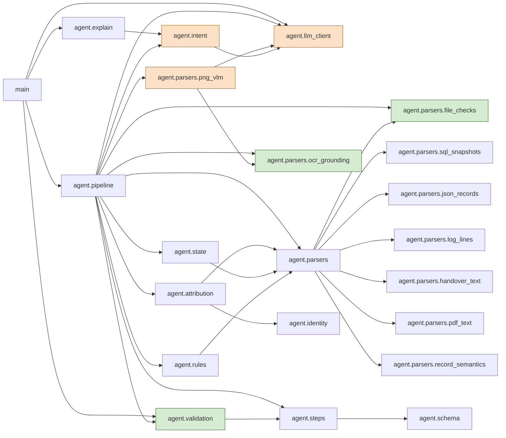

# DESIGN.md: Ghost Data Still Exists

Status: **Phase 0 (data forensics) complete. No production code yet.**
Every number below comes from `python code/analysis/profile_dataset.py` (section in brackets) unless it is labelled **INFERENCE**, **DECISION** or **UNKNOWN**.

---

## 1. Problem in one paragraph

For each row of `dataset/deletion_requests.csv` (518 rows, `case_33..case_550`), decide whether the person "actually requested deletion". If they did, reconstruct their current and historical identifiers and find every relevant record and recreation path. Then establish each record's state "at each case's `audit_at` time from the supplied evidence" and apply `deletion_rules.csv`. Emit `COMPLETE` with evidence-backed verification steps, `INCOMPLETE` with findings, an ordered remediation plan and post-remediation checks, or `NOT_APPLICABLE` with `[]`. `reported_status` and activity `reported_result` are "claims, not truth".

---

## 2. Output contract

`output.csv` at the repo root, UTF-8, comma-separated, header `case_id,deletion_status,steps_json`, exactly 518 data rows sorted by `case_id`. Case IDs are copied byte-for-byte from the input; they are never reformatted.

| Column | Allowed values (exact) | Source | Rule |
|---|---|---|---|
| `case_id` | input value | input row | O1 |
| `deletion_status` | `COMPLETE`, `INCOMPLETE`, `NOT_APPLICABLE` | code: `NOT_APPLICABLE` iff intent ≠ DELETION; else `INCOMPLETE` iff ≥1 finding; else `COMPLETE` | S1–S3 |
| `steps_json` | JSON array of step objects (below); `[]` for `NOT_APPLICABLE` | code: step generator | G1–G6 |

Step object: exactly the keys `step_no, phase, system_id, resource_id, operation, state, evidence_id`.

| phase | operation → state |
|---|---|
| FINDING | `REPORT_REMAINING_RECORD`→`PRESENT`, `REPORT_EXPOSED_PII`→`PRESENT`, `REPORT_ACTIVE_DATA_FLOW`→`ACTIVE`, `REPORT_RESTORE_RISK`→`ACTIVE` |
| REMEDIATION | `DISABLE_DATA_FLOW`→`DISABLED`, `BLOCK_RESTORE`→`BLOCKED`, `DELETE_RECORD`→`ABSENT`, `REDACT_RECORD`→`REDACTED`, `ANONYMIZE_RECORD`→`ANONYMIZED` |
| VERIFICATION | `VERIFY_RECORD_ABSENT`→`ABSENT`, `VERIFY_RECORD_PRESENT`→`PRESENT`, `VERIFY_RECORD_REDACTED`→`REDACTED`, `VERIFY_RECORD_ANONYMIZED`→`ANONYMIZED`, `VERIFY_DATA_FLOW_DISABLED`→`DISABLED`, `VERIFY_RESTORE_BLOCKED`→`BLOCKED` |

`evidence_id`: a manifest `file_id`, an `activity_id` or an `audit_id`, captured at or before `audit_at`. It is required on every FINDING and on every step of a `COMPLETE` case. It is `""` on every REMEDIATION step and on every VERIFICATION step of an `INCOMPLETE` case. Verified on all 32 samples by assertion (see §10).

---

## 3. Architecture

### Architecture as built (G9)

A **deterministic decision core** with **Gemini perception behind a typed seam**. The model does two jobs only:
it labels request intent (`agent.intent`) and reads the 11 screenshots into enum-validated observations
(`agent.parsers.png_vlm`). Everything that reaches the CSV (status, every step, every id, every citation) is
computed by code from typed records (Observation, Identifier, ActivityClaim, Attribution, ResourceState, Verdict).
Code verifiers sit on both sides of the seam: evidence admission checks before parsing (`file_checks`), multi-pass
OCR grounding after extraction (an id is accepted only if it is visibly on the screen, `ocr_grounding`), schema and
id validation of every model reply, and row/file validators before output.csv is replaced (`validation`).

**Why there is no free-form agent loop in the decision path.** One was built and measured: experiment E2, a
tool-calling investigator with five read-only tools and a deterministic verifier
([`code/analysis/e2_investigator.py`](code/analysis/e2_investigator.py),
[`e2_investigator_tools.py`](code/analysis/e2_investigator_tools.py),
[`e2_investigator_verifier.py`](code/analysis/e2_investigator_verifier.py)). On the samples it made 126 proposals,
all AMBIGUOUS; 0 were accepted. The ceiling is structural: the verifier may accept only identity-link support, and
any identity link the tools can reach is already a hard link that attribution marks CONFIRMED, so the loop can add
cost and risk but no correct decisions. It was removed from the pipeline and archived under `code/analysis/`.

Import graph of the shipped code (every arrow is an import, importer → imported; `agent.schema`, `agent.loaders` and
`agent.identity` are shared utilities and only their non-trivial edges are drawn; checked against the AST imports by
`code/tests/test_architecture_diagram.py`):



Orange: the only components that call a model (perception). Green: code verifiers. Everything else is the
deterministic core.

- Entry point: `code/main.py` (Phase 1). Forensics: `code/analysis/profile_dataset.py` (this phase).
- Stages, in order:
  `load CSVs` → `validate inputs` → `parse evidence → Observations` (deterministic; PNG via model, cached) → `intent` (model, cached per distinct text) → `identity resolution` → `resource discovery` → `state reconstruction at audit_at` → `category + treatment` → `step generation` → `output validation` → `write CSV`.
- **Workflow, not a free agent.** Every binding decision follows from the spec as a rule, and the dataset is adversarial to free-text reasoning (near-name decoys, claims that contradict evidence). A deterministic core is auditable and injection-immune.
- **The model has exactly two jobs:**
  (a) `request_text` → `{DELETION, NON_DELETION, UNCLEAR}`. This must be multilingual and negation-aware.
  (b) Extract PNG content (and the content of any PDF *without* a text layer) into the Observation schema, cached by SHA-256 of the file bytes plus the prompt version.
  Every resource id from (b) must then appear verbatim in local Tesseract OCR text of the same image (C9,
  `code/agent/parsers/ocr_grounding.py`, no model); ids that do not are dropped as UNGROUNDED. Identifiers must match
  a known identity exactly or are kept only as `unknown_identifiers`.
- **Code decides everything that reaches the CSV:** status, every step, every ID, every citation.
- **Experiment E2 (built, measured, not shipped):** a tool-calling investigator loop (`code/analysis/e2_investigator.py`)
  works one batch of unresolved pairs at a time. The model plans and calls five read-only tools
  (`find_by_identifier`, `activity_window`, `identity_history`, `resource_observations`, `batch_members`; at most 8
  calls per batch) and proposes ASSIGN/AMBIGUOUS. A deterministic verifier (`code/analysis/e2_investigator_verifier.py`)
  alone decides: it accepts only cited, existing tool results that show a shared identifier or user_id link, and it
  rejects contradicted hard links, double assignments and ordering-only arguments. On the samples it accepted 0 of 126
  proposals, so it is not wired into `code/main.py`.
- **Exit codes:** 0 ok; 2 validation failed (including self-contradicting rows, except INCOMPLETE `[]` with
  `reason_code=NO_ATTRIBUTABLE_RESOURCE`); 3 cache miss under `--from-cache` or no OCR cache/engine;
  4 model failure. On 2, 3 or 4 output.csv is never replaced; `--allow-degraded` writes output.degraded.csv.
- **Hard constraints:**
  - The model never writes `deletion_status`, `operation`, `resource_id`, `system_id` or `evidence_id` into the output.
  - Model outputs are validated against enums and known IDs before use (§7).
  - No rule is keyed on a case_id, email or resource_id literal. A grep test enforces this in Phase 1.
  - `UNCLEAR` → `NOT_APPLICABLE`, counted and logged. A destructive plan is never issued without clear authorization.

---

## 4. The seam (typed records)

The parsers, identity resolution, state reconstruction and the rule engine communicate **only** through these records. The rules read enums and booleans, never free text.

```text
Observation                          # one sighting of one resource in one evidence file
  obs_id: str                        # "<file_id>#<locator>" (table+rowid / json path / log line)
  file_id: str                       # must exist in evidence_files.csv
  file_captured_at: datetime         # manifest captured_at
  observed_at: datetime | None       # record/line/inner-snapshot time; None -> file_captured_at
  source_kind: SQL_TABLE | JSON_COLLECTION | JSON_POINT_LOOKUP | RECORD_LEDGER | LOG_EVENT | PDF_TEXT | IMAGE_EXTRACTION
  system_id: str                     # stated by the file, else learned prefix map (section 1: 0 conflicts)
  copy_role: PRIMARY | READ_REPLICA | REPORTING_REPLICA | FAILOVER_REPLICA | REGIONAL_REPLICA | SINGLE
  container: str                     # table / collection / log event name
  resource_id: str
  record_shape: str                  # canonical shape key read by category rules (e.g. "analytics+email_opt_in")
  presence: PRESENT | ABSENT | UNKNOWN          # 404/rows=0/NOT_FOUND/miss -> ABSENT
  exposure: DIRECT_IDENTIFIERS | NO_DIRECT_IDENTIFIERS | REDACTED | UNKNOWN
  flow_state: ENABLED | DISABLED | UNKNOWN | None          # integration connectors
  restore_state: RESTORABLE | BLOCKED | UNKNOWN | None     # backups
  stated_category: <deletion_rules data_category> | None   # record_type when the file states it
  identifiers: list[Identifier]
  attributes: dict[str, scalar]      # raw fields kept for the audit trail; rules never read them
  extraction: DETERMINISTIC | MODEL  # MODEL only for IMAGE_EXTRACTION

Identifier
  kind: email | email_hash | phone | user_id | name
  value: str                         # emails lower-cased; others exact
  field: str                         # e.g. correlation_key, subject_reference, lookup_key
  provenance: SAME_RECORD | TRACE_JOIN | DOCUMENT_COMENTION | CATALOG_LINK | SOURCE_REFERENCE

ActivityClaim                        # one system_activity.csv row; a claim, never a state
  activity_id, event_time, event_type, source_system, target_system, resource_id,
  reported_result: SUCCESS | PARTIAL | FAILED, mentioned_ids: list[str], mentioned_identifiers: list[Identifier]

Subject                              # per case
  user_id, identifiers: dict[kind -> {value: provenance}]

ResourceVerdict                      # per (case, resource); the only input to the step generator
  system_id, resource_id, category, required_action: DELETE|REDACT|ANONYMIZE|RETAIN|BLOCK|DISABLE,
  state_at_audit: PRESENT|ABSENT|EXPOSED|REDACTED|ANONYMIZED|ACTIVE|DISABLED|RESTORABLE|BLOCKED|UNKNOWN,
  compliant: bool, proof_file_id: str | None, link_provenance: str, link_confidence: DIRECT | ELIMINATION
```

Model outputs map onto these: intent → `IntentLabel{label, language, negation_detected: bool}`; image extraction → `list[Observation]` with `extraction=MODEL`.

---

## 5. Decision rules

### 5.1 Status (first match wins)

| Order | ID | Condition | Outcome |
|---|---|---|---|
| 1 | S0 | case processing raised (after the per-case try/except) | `INCOMPLETE`, `[]`, logged as DEGRADED (§8) |
| 2 | S1 | intent ∈ {NON_DELETION, UNCLEAR}, or `CLASSIFY_REQUEST` for the subject says non-deletion while intent = DELETION (disagreement → UNCLEAR) | `NOT_APPLICABLE`, `[]` |
| 3 | S2 | ≥1 ResourceVerdict with `compliant = false` | `INCOMPLETE` |
| 4 | S3 | otherwise | `COMPLETE` |

S1 comes before the evidence rules because the spec puts intent first ("First determine whether `request_text` authorizes deletion"). An unauthorized destructive plan is the worst error this system can make.

### 5.2 Category → treatment (from `deletion_rules.csv`; the record shape decides, not the system name)

| Category (rule) | Required action | Shape that maps to it [section 3] | Non-compliant state → finding / remediation | Verification |
|---|---|---|---|---|
| USER_PROFILE (rule_01) | DELETE | account_service profile row/lookup/ledger | PRESENT in any copy → `REPORT_REMAINING_RECORD` / `DELETE_RECORD` | `VERIFY_RECORD_ABSENT` |
| SEARCH_INDEX_ENTRY (rule_03) | DELETE | search document / index hit | PRESENT → same | `VERIFY_RECORD_ABSENT` |
| USER_EXPORT (rule_09) | DELETE | export job / export object | PRESENT → same | `VERIFY_RECORD_ABSENT` |
| SUPPORT_ATTACHMENT (rule_06) | DELETE | ticket_attachments, `attachment_pii_scan`, ledger `SUPPORT_ATTACHMENT`, PDF naming a support id | PRESENT → same | `VERIFY_RECORD_ABSENT` |
| MARKETING_PROFILE (rule_10) | DELETE | analytics record carrying `email_opt_in` (**INFERENCE**: 1 sample, case_12; SECONDARY_IDENTIFIER would give the same treatment) | PRESENT → `REPORT_REMAINING_RECORD` / `DELETE_RECORD` | `VERIFY_RECORD_ABSENT` |
| ANALYTICS_PROFILE (rule_07) | ANONYMIZE | analytics profile/report | direct identifiers present → `REPORT_EXPOSED_PII` / `ANONYMIZE_RECORD` | `VERIFY_RECORD_ANONYMIZED` |
| SUPPORT_MESSAGE (rule_05) | REDACT | conversation / ticket / message scan | direct identifiers present → `REPORT_EXPOSED_PII` / `REDACT_RECORD` | `VERIFY_RECORD_REDACTED` |
| ACCOUNT_TOMBSTONE (rule_15) | REDACT | identity_service deleted_customer_references | name/email/phone/hash present → `REPORT_EXPOSED_PII` / `REDACT_RECORD` | `VERIFY_RECORD_REDACTED` |
| SECURITY_AUDIT_LOG (rule_12) | RETAIN | security audit record (retention_until is always in the future in observed data) | none (keep) | `VERIFY_RECORD_PRESENT` |
| BACKUP_ARCHIVE (rule_14) | RETAIN + block restore | backup catalog / restore entry | restorable → `REPORT_RESTORE_RISK` / `BLOCK_RESTORE` | `VERIFY_RESTORE_BLOCKED` |
| (data flow, not a rules category) | DISABLE | integration connector | enabled → `REPORT_ACTIVE_DATA_FLOW` / `DISABLE_DATA_FLOW` | `VERIFY_DATA_FLOW_DISABLED` |
| LEGAL_HOLD_RECORD (rule_13) | RETAIN | legal_service retained order | none | `VERIFY_RECORD_PRESENT` (**UNKNOWN**: 0 sample answers contain one) |
| CACHE_ENTRY, EMAIL_DELIVERY_LOG, PRODUCT_TELEMETRY, SECONDARY_IDENTIFIER | per rules | **no evidence shape observed** [section 3]; activity only | not emitted | — |

The samples confirm this table: every one of the 111 expected (case, resource) pairs follows it [section 3, "expected treatment per resource prefix"]. The deletion_worker activity event type agrees with the expected treatment on all 85 pairs that have such a row; the other 26 pairs (24 audit records, `account_004`, `support_001`) have none.

### 5.3 Step generation (deterministic)

- **G1:** For each non-compliant verdict: one FINDING (cites `proof_file_id`) + one REMEDIATION (`""`).
- **G2:** For every relevant verdict, compliant or not: one VERIFICATION.
  - `COMPLETE`: it cites `proof_file_id`.
  - `INCOMPLETE`: `""`.
  - The samples show that INCOMPLETE verification covers already-compliant records too (e.g. the absent account, the retained audit record).
- **G3:** Sort by (phase order, operation order in the problem statement's table, `system_id`, `resource_id`), ascending. This reproduces **32/32** sample sequences exactly. No sample has two resources sharing (phase, operation, system), so whether `resource_id` sorts lexicographically or numerically is **UNKNOWN**. DECISION: plain string order, as the README says "ascending".
- **G4:** Renumber `step_no` from 1.
- **G5:** Serialize with `json.dumps(steps, ensure_ascii=False, separators=(",", ":"))` and fixed key order. Write the CSV with the stdlib `csv` module, `QUOTE_MINIMAL`, `\n` line endings.
- **G6:** The validator re-parses every row before writing (§10, hard gates).

The remediation order "disable flows and block restores before changing dependent records" is already implied by the operation table order. **UNKNOWN**: whether the spec's "process downstream copies before their source records" ever reorders steps beyond G3. The samples never show it.

### 5.4 Identity rules (with provenance)

- **ID1 (resolve):** the request email, trimmed and lower-cased, is matched exactly against `user_identities.email` (current) and `user_audit_log` email `old_value`/`new_value` (historical). Measured: **550/550** requests resolve to exactly one user. 445 match the current email only, 103 a historical email only, and 2 both current and `new_value` [section 6].
- **ID2 (identifier set):** `user_id`, plus the current email, phone, email_hash and name, plus every historical `old_value`/`new_value` for that user. Each value carries its provenance, e.g. `user_audit_log.old_value audit_121`.
- **ID3 (link a resource):** a resource belongs to the subject when an admissible Observation of it carries an identifier from the set. Emails match exactly but case-insensitively (16 emails appear upper-cased in evidence, e.g. `CHOI.JIHOON94@GMAIL.COM`). Hashes, phones and user_ids match exactly. Link provenance:
  - SAME_RECORD
  - TRACE_JOIN: the log's `lookup_key`/`match_key`/`subject_key`/`scan_key`/`subject_ref`/`correlation_key` on another line with the same trace_id (310 observations gain identifiers this way).
  - DOCUMENT_COMENTION: the PDF text layer.
  - CATALOG_LINK: `LINK_RESOURCE_IDENTITY` (12 rows).
  - SOURCE_REFERENCE: `search_documents_primary.source_resource_id`.
- **ID4 (never fuzzy):** no fuzzy matching. A name alone never links. Measured: 3 names are owned by two users each (Gabriel Costa, Mateo Ríos, Thandiwe Ndlovu). Near-name decoys sit inside evidence: `Karim El-Masri`/`Mateo Rios Gil`/`Priya Ramanathan` in evidence_54, `jonas.berglund@outlook.com` in evidence_57, `smartinez6461.jr@gmail.com` in evidence_02 [section 6].
- **ID5 (activity nomination):** deletion_worker activity rows *nominate* resources for a case; they never establish state. An activity-only resource with no identifier link is attributed to a case only by elimination inside a time window around `reported_at`, and its verdict is tagged `link_confidence=ELIMINATION`. **This is the largest open risk (§12).**
  - Samples: 24 of 111 expected pairs are activity-only (17 accounts, 7 analytics); 3 have no text source at all [section 6].
  - Eval: 284 of 518 cases have **no** evidence-linked account-delete candidate within ±3 h of `reported_at`. Of those, 16 have no candidate in the window at all: 4 are non-deletion texts and 12 are deletion cases whose account delete falls outside ±3 h [section 5].

### 5.5 State at `audit_at`

- **T1 (admissible observation):** the file's `captured_at` ≤ `audit_at` (inclusive), **and** the observation's own time (`observed_at`/`recorded_at`/line time/inner snapshot time) ≤ `audit_at`.
  - Inclusive is confirmed: 7 sample cases cite a file whose `captured_at == audit_at` (cases 11, 13, 14 → evidence_03; 16, 22 → evidence_05; 31, 32 → evidence_51) [section 4].
  - The per-record check matters: evidence_13 and evidence_36 each contain one record dated 2 days *after* the file's capture (a FOUND following a NOT_FOUND) [section 1].
- **T2 (copies are separate):** each table role (primary, read/reporting/failover/regional replica) is its own copy. Any PRESENT copy makes the record PRESENT.
  - 13 replica-drift rows exist across the SQL files [section 1].
  - e.g. `account_005` is in failover only (case_05 INCOMPLETE); `account_994` is in read_replica only (case_16 INCOMPLETE).
- **T3 (latest wins per copy):** per (resource, copy), take the admissible observation with the greatest (file_captured_at, observed_at). Lookup-start log lines are not observations of state.
  - 14 resources flip between found and not-found inside one file. e.g. `account_5284` returns 404 on 07-28 and 200 on 07-30 in evidence_16 [section 1].
- **T4 (claims):** `reported_status` and `reported_result` are never state.
  - Measured contradictions: `search_1007` has DELETE SUCCESS (09-01) but is present in evidence_05 (09-21) → case_16 INCOMPLETE. `account_5334` has DELETE SUCCESS, then a SYNC to the replication cluster, then FOUND in evidence_92 → case_24 INCOMPLETE [section 7].
- **T5 (absence by omission):** if a resource has no admissible observation but a full table/collection snapshot of its system exists ≤ `audit_at`, its state is ABSENT, proven by that snapshot (see citation rule C).
- **T6 (three concepts kept apart in the audit trail):** *reported* (activity claim), *observed* (each Observation with its time), and *reconstructed@audit_at* (T1–T5).
- **Discovery vs citation, DECISION PENDING (§11 D11):** may a file captured after `audit_at` be used to *discover* that a resource belongs to the subject, when the observation inside it is dated ≤ `audit_at`? It is never used for state or citation.
  - Measured: 7 of 111 sample pairs need this policy, all for INCOMPLETE verification steps that carry no citation. e.g. case_24 `audit_record_7095` is only visible in evidence_02 (file 09-17, inner snapshot 09-15T12:00 = `audit_at`) [section 6].

### 5.6 Citation rule (measured on the 75 cited sample steps) [section 4]

| Hypothesis | Match |
|---|---|
| A_raw: latest file ≤ audit_at whose **raw bytes** mention the resource_id | 70/75 |
| A: same, with the PDF text layer extracted | 71/75 |
| A_email / A_email_cs: latest file mentioning the request email (case-insensitive / exact) | 44/75 / 44/75 |
| A_ids: latest file mentioning any subject identifier | 71/75 |
| A′_scope: latest file covering the resource's system | 36/75 |
| A′_full: latest full table/collection snapshot of the system | 12/75 |
| **C: A if any admissible file mentions the resource_id, else A′_full** | **74/75** |

- **Adopted: C.**
- Mismatches under A: `account_001`, `account_002`, `account_004` (all expected evidence_54) and `account_4857` (expected evidence_51). None of these IDs is mentioned in any evidence file; C fixes three of them.
- The one miss under C is case_04 / `account_004`. Expected evidence_54 (09-02T23:00); C picks evidence_90 (09-05T07:18), an inventory whose only `snapshot_scope` row is `account_service` with zero rows in every table. Whether such an empty inventory counts as a full snapshot is **UNKNOWN**. The samples cannot distinguish "hand-picked" from a rule. 9 unreadable PNGs also fall inside that window.
- Every cited file was captured ≤ `audit_at` (min gap 0 s, max 5.6 days).
- Each case cites one file for all its steps, except case_04 (evidence_54 + evidence_56).
- I could not reproduce your stated 43/75 for "latest file mentioning the subject email"; both the case-sensitive and case-insensitive variants give 44/75. The cause is **UNKNOWN**.

---

## 6. Escalation and refusal (mapped to this task)

- **Act (emit a plan):** intent = DELETION, the subject resolves, and verdicts exist.
- **Refuse (`NOT_APPLICABLE`):** intent is NON_DELETION or UNCLEAR, or the model and `CLASSIFY_REQUEST` disagree.
- **Default when evidence is missing:**
  - A relevant resource with no admissible observation and no covering snapshot gets `state_at_audit=UNKNOWN`.
  - It is non-compliant only if its last admissible claim or observation was non-compliant. Otherwise it is verified without a proof file, which forces the case to `INCOMPLETE`: a COMPLETE step needs a citation, so code never asserts COMPLETE without proof.
- **Why neither extreme works:** the samples are 10 COMPLETE / 22 INCOMPLETE. The eval `reported_status` mix is 254 COMPLETE / 152 PARTIALLY_COMPLETE / 112 NOT_STARTED, and contains exactly 10 non-deletion texts [sections 1, 8]. "Always INCOMPLETE" fails every true COMPLETE. "Trust reported_status" fails cases 05, 07, 10, 11, 12, 14, 15, 18, 22, 24, 30 (reported COMPLETE, truly INCOMPLETE) and cases 25, 26, 28 (reported NOT_STARTED, truly COMPLETE).

---

## 7. Input validation and model-output guardrails

| Check | Action |
|---|---|
| Missing/empty required request field, unparsable timestamp, duplicate case_id | Row still emitted; case → S0 degraded, logged |
| Request email resolves to 0 or >1 users | No deletion plan; `INCOMPLETE`,`[]`, logged (never happens on current data: 550/550 resolve to one) |
| Manifest file missing on disk / magic bytes ≠ extension | File contributes no observations; logged (current data: 0 missing, 0 mismatches) |
| SQL fails to load in SQLite / unknown JSON or log shape | File skipped, logged; run continues |
| `request_text` passed to the model | Wrapped as untrusted data with a fence; instructions inside are ignored by prompt and are structurally inert, because the model can only return an enum |
| Intent output not in `{DELETION, NON_DELETION, UNCLEAR}` | Retry ×2 with the error fed back; then UNCLEAR |
| Image extraction output | Each Observation is schema-validated. `system_id` must be in the learned system set. `resource_id` must match a known prefix; a resource unseen elsewhere is accepted only if the same image row also carries a subject identifier. `presence`/`exposure` must be enums. Anything else is dropped and logged. The model never supplies `evidence_id`: provenance is the image's own `file_id` |

---

### 7.1 Threat model (C7)

Untrusted inputs are `request_text` (written by the requester), every evidence file (logs, JSON, SQL, PDFs and
screenshots can carry text written by anyone who touched the source system) and model replies. The asset is the
output row: an attacker wins by turning a deletion request into COMPLETE or NOT_APPLICABLE, by suppressing a finding,
or by getting another person's record deleted. Controls: (1) the model never decides status or steps; it returns an
intent label from a closed enum (anything else fails validation) and enum-checked screenshot fields, and code maps
those to the output; (2) request texts are fenced with a per-text nonce tag and the prompt declares them data;
(3) empty texts make no call and texts are capped at 5,000 characters, so padding cannot hide an instruction in a
huge prompt or inflate cost; (4) logs, JSON, SQL and PDF text are parsed by deterministic code and never shown to a
model, so an instruction in a log line is just an unknown field; (5) screenshot ids must appear in local OCR text
(C9) and identifiers must exactly match a known identity, so a model misled by an image cannot invent a record or
link one to the subject; (6) the validator rejects any row that contradicts itself. Residual risks: an injected
text may still flip the intent label (DELETION ↔ UNCLEAR) because that label *is* the model's job; X14/X15 show the
label held on these attacks, not that it always will. A screenshot could show a fake id in its pixels; OCR grounding
proves only that the id is visible, not that it is genuine. Measured by fixtures X14–X19 (6/6 pass).

G8 extends the threat model to the evidence files themselves: a manifest path can point outside the dataset (rejected by `resolve_inside`), a file can lie about its type (magic bytes), be corrupt or truncated (PNG CRC/IEND, PDF `%%EOF`, SQL transaction never committed) or be missing. Each is rejected and counted, the run fails closed (§8.1) and exits 4, so an attacker who can tamper with evidence can make the run refuse, never make it claim COMPLETE. A crafted 1 MB line could stall a parser regex: seven quadratic patterns were found and bounded; all product regexes now finish a 1 MB adversarial line within 2 s (`code/evaluation/security_audit.py`).

## 8. Failure handling

### 8.1 Failure semantics (G8; enforced in code and asserted by `code/evaluation/security_audit.py`)

1. **Reject and log.** An evidence file that is missing, corrupt, truncated, of the wrong type, or whose manifest path
   escapes the dataset directory is rejected before parsing (`code/agent/parsers/file_checks.py`). Its observations
   are dropped, it is listed in `_run_summary.json` under `evidence_rejected` with its status and reason, and it
   counts as a **DEGRADE** event. The run continues and every case still gets a row.
2. **Fail closed.** A case may never be COMPLETE if a verification it needs could have depended on a dropped
   observation: when a rejected file was captured after a verification's proof file and at or before the case's
   audit_at, it could hold a newer observation, so that proof no longer establishes the state. The case becomes
   INCOMPLETE, its checks become future checks (evidence ""), and the trace carries
   `reason_code=DEPENDS_ON_DROPPED_EVIDENCE` with the file ids (the M2/C5 rule: an unproven state is not proof).
3. **Never replace the accepted output.** Any DEGRADE event (a rejected evidence file, a failed intent call, a skipped
   screenshot) makes the run exit **4**. output.csv is not replaced; with `--allow-degraded` the rows go to
   `output.degraded.csv` for diagnosis (C0 semantics).

| Failure | Detected by | Status | Row | Exit |
|---|---|---|---|---|
| Manifest path absolute or `..` escape | `resolve_inside` | REJECTED_PATH | every case gets a row; fail closed where it applies | 4 |
| File named by the manifest missing | `is_file()` | MISSING | as above | 4 |
| Content contradicts extension (PNG named .json, JSON named .png, binary in a text format) | magic bytes | WRONG_TYPE | as above | 4 |
| PNG with a bad chunk CRC or no IEND; PDF without `%%EOF` | `file_checks.check` | CORRUPT | as above | 4 |
| SQL export that opens a transaction and never commits | `file_checks.check` | TRUNCATED | as above | 4 |
| Any parser exception | parser try/except | PARSE_ERROR | as above | 4 |
| Intent call fails on every (model, key) | `AllProvidersFailed` | model failure | `NOT_APPLICABLE` (no decision), counted | 4 |
| Screenshot extraction fails | `AllProvidersFailed` | vlm_files_skipped | no observations from that image | 4 |
| Model reply fails the schema | validator, 2 retries with the error fed back, then the next (model, key) | — | as above if all fail | 4 if all fail |
| Unexpected exception in one case | per-case try/except | degraded | `INCOMPLETE`, `[]`, traceback tail in the trace | 2 (self-contradicting row) |
| A row fails row validation | `validate_row` | validation_failed | `INCOMPLETE`, `[]` | 2 |
| Cache miss under `--from-cache` (or no OCR cache and no Tesseract) | `CacheMiss` | — | no output written | 3 |
| Row count, ids or order wrong | `validate_output_file` | — | output.csv untouched | 2 |

Model calls are cached (content hash + prompt version), so an interrupted live run resumes and pays only for the rest.

---

## 9. Retrieval

There are no embeddings. Retrieval is exact and index-based: identifier → observations, resource_id → observations/claims, system → full snapshots. Recall is measured against the samples' 111 expected pairs (§10). Of those, 76 link directly through files captured ≤ `audit_at`, 7 more under the pending discovery policy, 24 through activity only, and 3 have no text source (presumably PNGs) [section 6].

---

## 10. Test and validation plan

**Hard gates (no non-zero value allowed):**
- 518 rows, sorted, exact header.
- Every `steps_json` parses, is numbered consecutively from 1, and uses only the enum values.
- Every cited ID exists in the manifest/activity/audit log and was captured ≤ `audit_at`.
- `""` exactly where the contract requires it.
- `NOT_APPLICABLE` ⇔ `[]`.
- Two runs from cache produce identical SHA-256.
- A grep finds no case_id/email/resource literal in decision code.

**Sample regression (measured after each change, never used to pick thresholds):**
- Case status accuracy.
- Step-level exact match: the (phase, system, resource, operation, state, evidence) tuple.
- Field-level accuracy per key.
- Sequence accuracy: exact array equality.

The contract assertions above already pass on `sample_output.csv` itself (sort rule 32/32; evidence-id rule 32/32).

**Ablations (P3: prove the counterfactual):**

| Turn off | Expected effect |
|---|---|
| PDF text layer | Loses the support_001 link and citation (A 71 → 70) |
| Trace join | Loses links such as case_09 account_3960 and case_12 account_9797 |
| Historical identifiers | Loses case_10 support_002, case_12 analytics_9914, case_29/30 links |
| Replica copies (T2) | Flips case_05 to COMPLETE; case_16 loses its `account_994` finding |

**Coupling probes:** shuffle manifest and activity row order; rename the evidence folder; verify formats by magic bytes; identifiers are matched by value, never by regex shape.

**Custom evaluation cases (5; ≥3 required).** Fixture IDs use a `99xxxx` range and `example.test` emails, so they cannot collide with the dataset.

| # | Failure mode | Input (fixture) | Expected output | Why naive logic fails | Spec rule |
|---|---|---|---|---|---|
| X1 | Negated, limited-scope, non-English non-deletion | Request: "No quiero borrar mi cuenta. Solo dejen de enviarme correos promocionales; necesito conservar mi historial de pedidos." Evidence ≤ audit shows `account_990001` FOUND for the subject; activity has a DELETE_RECORD on the subject's search entry (decoy) | `NOT_APPLICABLE`, `[]` | A keyword ("borrar") or evidence-first pipeline sees a present account and emits `REPORT_REMAINING_RECORD` + `DELETE_RECORD`: a destructive plan the person explicitly refused | §6.5 bullet 1 ("marketing opt-out … is NOT_APPLICABLE"); problem statement "NOT_APPLICABLE because the person did not request deletion" |
| X2 | Historical-identifier-only linkage + shape decides category | Request email = the subject's **old** email (`user_audit_log.old_value`). Log ≤ audit: `analytics_990002 event=contact_lookup_completed rows=1 email_opt_in=true correlation_key=<old email_hash>`; `account_990002` 404 under the current email; `audit_record_990002 subject_reference=<user_id>` | `INCOMPLETE`: 1 FINDING analytics_platform/analytics_990002 `REPORT_REMAINING_RECORD` PRESENT <log>; 2 REMEDIATION `DELETE_RECORD` ""; 3 VERIFY account_990002 ABSENT ""; 4 VERIFY analytics_990002 ABSENT ""; 5 VERIFY security_service/audit_record_990002 PRESENT "" | Current-identifier-only matching misses the record → COMPLETE. System-name categorisation calls it ANALYTICS_PROFILE → `REPORT_EXPOSED_PII` + `ANONYMIZE_RECORD` | §6.5 "Resolve both current and historical identifiers"; §6.6 "Match evidence through … hashes"; rule_10 vs rule_07 (mirrors sample case_12) |
| X3 | Post-delete replication recreation (replica drift) under `reported_status=COMPLETE` | Activity: `DELETE_RECORD account_990003 SUCCESS` at T, `SYNC_RECORD account_service→account_replication_cluster account_990003 SUCCESS` at T+2h. SQL read-replica snapshot ≤ audit: absent from `customer_data_primary`, present in `customer_data_read_replica` with the subject's email; audit record in both | `INCOMPLETE`: 1 FINDING account_service/account_990003 `REPORT_REMAINING_RECORD` PRESENT <sql>; 2 `DELETE_RECORD` ""; 3 VERIFY account_990003 ABSENT ""; 4 VERIFY audit_record_990003 PRESENT "" | Trusting `SUCCESS`/`COMPLETE`, or reading only the primary table, yields COMPLETE | §6.6 "SQL evidence can contain … replicas. Compare the relevant tables"; §6.5 "do not accept reported_status" (mirrors case_16/case_24) |
| X4 | Temporal boundary: inclusive `audit_at`, and a resurrection dated after `audit_at` inside an admissible file | Ledger captured **exactly at** `audit_at`: `search_990004 NOT_FOUND @audit_at`, plus a row `search_990004 FOUND @audit_at+2d` (recorded after capture). A later file (captured > audit) also shows FOUND. Account absent ≤ audit; audit record present | `COMPLETE`: VERIFY account ABSENT <ledger>; VERIFY search_990004 ABSENT <ledger>; VERIFY audit record PRESENT <ledger> | "Latest observation wins" without a time filter → INCOMPLETE. Treating `captured_at == audit_at` as inadmissible → cites an older file or finds no proof | §6.2 "Use only information available at or before audit_at … Evidence created later must not change the answer"; §6.6 "Never cite … an evidence item captured after audit_at" (mirrors evidence_13/36, case_11) |
| X5 | Absence by omission + near-name decoy | Subject "Rhea Vale" (`rhea.vale@example.test`); activity `DELETE_RECORD account_990005 SUCCESS`; failover SQL snapshot ≤ audit has `account_990777 'Rhea Valentine' rhea.valentine@example.test` in primary and replica; `account_990005` in neither | `COMPLETE`: 1 VERIFY account_service/account_990005 ABSENT <sql snapshot> | A fuzzy name/email matcher treats Rhea Valentine's row as the subject's → INCOMPLETE with `DELETE_RECORD` on **someone else's** account | §6.6 "Global data can contain decoys"; ID4 exact matching; citation rule C fallback (mirrors case_01/case_02) |

---

## 11. Decisions log

| # | Decision | Alternative rejected | Why (measured where possible) |
|---|---|---|---|
| D1 | Deterministic rule engine; the model only classifies intent and extracts images | LLM agent writes status/steps | IDs, citations and order must be exact and auditable. A model can hallucinate IDs and is open to injection through `request_text` |
| D2 | PDF text via a stdlib text-layer decoder (zlib/ASCII85/ToUnicode) | Send PDFs to a vision model | 4/4 PDFs have a deterministic text layer. It recovers `support_001` → evidence_58 (A_raw 70 → A 71/75) at zero tokens |
| D3 | Citation rule C | A (71/75), A_email (44/75), A′_scope (36/75), A′_full (12/75) | C = 74/75; its single miss is UNKNOWN, not wrong-by-mechanism |
| D4 | Exact identifier matching; emails case-insensitive | Fuzzy name/email matching | Decoys are planted (Karim El-Masri, Mateo Rios Gil, Priya Ramanathan, jonas.berglund, smartinez6461.jr); 3 names collide across users |
| D5 | Category from record shape (+ stated record_type) | Category from system_id | case_12's analytics_9914 (`email_opt_in`) must be DELETE, not ANONYMIZE |
| D6 | Activity = nomination + treatment hint, never state | Use `reported_result` as state | The event type agrees with the expected treatment on all 85 sample pairs that have such a row, but SUCCESS is contradicted by evidence (case_16 `search_1007`, case_24 `account_5334`) |
| D7 | Admissibility checks both file time and record time, inclusive | File time only | 2 ledger rows are dated after their file's capture (evidence_13, evidence_36); 7 sample cases cite a file with `captured_at == audit_at` |
| D8 | Replica copies are separate copies; any present copy → PRESENT | Primary table only | 13 drift rows; cases 05 and 16 depend on it |
| D9 | Intent cached per distinct text; `CLASSIFY_REQUEST` corroborates (refined by D-INTENT below) | `CLASSIFY_REQUEST` as authority / keyword rules | The spec says text decides and activity is a claim. 10/10 CLASSIFY rows match the 10 free-text non-deletion eval cases; keyword rules fail on negation ("not asking for deletion", "don't delete or change anything") |
| D10 | Degraded row = `INCOMPLETE`,`[]` | `NOT_APPLICABLE`,`[]` / `COMPLETE` | NOT_APPLICABLE falsely says no deletion was requested; COMPLETE is unsafe without proof |
| D11 | **DECIDED (user, Phase 1):** files captured after `audit_at` may be used for *discovery* of resource→subject links only. Never for state, never for `evidence_id` | Forbid post-audit files entirely | 7/111 sample pairs depend on it; state and citation stay strictly ≤ `audit_at` (T1, rule C) |
| D12 | Superseded by D-ATTR | — | — |
| D13 | Images: model extraction with content-hash cache | Ignore PNGs | 3 expected sample resources (`account_004`, `audit_record_6645`, `audit_record_5569`) appear in no text source, consistent with living in a PNG (**INFERENCE**). Phase 1 found 11 eval cases (case_34, 35, 39, 45, 46, 50, 52, 53, 55, 61, 63) whose key resource is catalog-linked to a PNG captured 7 minutes before the catalog row |

### Phase 1 decisions (recorded before building)

| # | Decision | Alternative rejected | Why |
|---|---|---|---|
| D-ATTR | Attribution is a separate module (`code/agent/attribution.py`) solved as a global constrained assignment per activity batch. **Edges:** hard identity links (email / phone / email_hash, current + historical; `customer_reference`/`subject_reference`/`user_id` == user_id; data-catalog links), each recording source id, identifier type, time and strength; plus timing edges from deletion_worker rows within ±3 h of `reported_at`, which **only generate candidates**. **Constraints:** a resource hard-linked to one subject is eliminated from every other case. One-to-one assignment applies only to the deletion-worker account delete (one per case per burst); a case may own several resources across systems and copies. **Labels:** CONFIRMED (direct unambiguous identity link); INFERRED (edge present in every maximum assignment, with the rationale recorded); AMBIGUOUS (more than one assignment equally supported); CONFLICT (hard links to different user_ids). A deterministic tiebreak may fix ordering but never upgrades AMBIGUOUS. **Output policy:** only CONFIRMED and INFERRED produce steps; AMBIGUOUS and CONFLICT produce none and are counted in traces and the evaluation report | (a) Nearest-in-time assignment; (b) dropping every activity-only resource | (a) Timing alone cannot separate interleaved bursts: on 2026-09-02, 10:48–11:10, five account deletes (3136, 4842, 5334, 5684, 7225) sit inside five cases reported at 12:00 (case_24/25/26/549/550). (b) loses 24/111 expected sample pairs. Emitting remediation against data that may belong to another person is the worst failure, so ambiguity yields no steps |
| D-SCOPE | A resource enters a case's scope only (a) through identity-linking evidence whose time falls within `[requested_at, audit_at]`, or (b) through the case's own deletion burst (an attributed deletion-worker row) | Every resource ever linked to the subject | Three users filed two requests each (user_07: case_07/case_61; user_17: case_17/case_46; user_18: case_33/case_52). On the samples, the rule keeps 84/84 expected hard- or catalog-linked pairs and excludes the 3 not-expected ones (`object_19`, `account_6523`, `tombstone_17`, all evidence from the user's earlier request). No numeric margin was tuned: the window is the request's own lifecycle |
| D-UNKNOWN-STATE (amended by rc7-X4) | A scoped resource with no admissible observation and no admissible full snapshot of its system gets no finding and no remediation (logged as `UNKNOWN_STATE`). Since rc7-X4, an INCOMPLETE plan lists the check its policy requires afterwards (evidence ""), and a COMPLETE row still drops it | Emit a verification step without proof | A step must be evidence-backed for COMPLETE, and a finding needs evidence |
| D-CITE | Citation rule C: latest file captured ≤ `audit_at` that mentions the resource_id; if none does, the latest full snapshot of that system ≤ `audit_at`. 74/75 on samples | Rule A (71/75); A′ (36/75, 12/75) | Highest measured match; the one miss is logged in the rejection log below and not chased |
| D-SORT | `resource_id` sorts as a string, ascending, inside (phase, operation order, system_id). **Untested assumption:** no sample has two resources in the same (phase, operation, system) | Numeric-suffix sort | The README says "ascending"; the samples cannot distinguish the two |
| D-INTENT | The model classifies `request_text` → {DELETION, NON_DELETION, UNCLEAR}, multilingual and negation-aware, cached by sha256(task + prompt_version + text). UNCLEAR → `NOT_APPLICABLE` is spec-grounded: problem_statement.md line 19, "`NOT_APPLICABLE` because the person did not request deletion", and line 91, "For `NOT_APPLICABLE`, use an empty JSON array (`[]`) because no deletion or deletion verification is authorized." CLASSIFY_REQUEST rows corroborate and are not labels. **Path:** DELETION only if the model says DELETION and no CLASSIFY_REQUEST non-deletion row exists for an account linked to the subject; every other combination → `NOT_APPLICABLE`. Disagreements are logged and each path is counted | CLASSIFY_REQUEST as the label; keyword rules | The spec makes the text authoritative; keyword rules fail on negation |
| D-INTENT-BATCH | Uncached texts are sent in batches (one call classifies up to N fenced texts, each with its own id); every text still gets its own cache entry | One call per text | The estimate of ~56 calls assumed one call per template; caching is per *full text* and the eval set has 375 distinct texts (67 template sentences combine into texts). Batching keeps calls well inside free-tier daily quotas. The call count is reported as measured |
| D-VLM | The 11 PNGs are extracted once into the Observation schema. Every extracted `resource_id`/`system_id` is validated against the known prefixes and systems before use; invalid rows are dropped, counted and logged | Ignore PNGs; trust raw model output | See D13 |
| D-MODELS (revised twice by user) | Gemini only, four keys used as an ordered fallback chain: `GEMINI_API_KEY`, `GEMINI_API_KEY_FALLBACK_1`, `GEMINI_API_KEY_FALLBACK_2`, `GEMINI_API_KEY_FALLBACK_3` (a missing or empty slot is skipped and logged). Ordered (model, key) lists per task live in `code/config/models.yaml`: vision = Flash on each key in order, then Flash-Lite on each key; text = Flash-Lite on each key in order, then Flash on each key. Model ids are verified against the provider's model list before the first call. Fallback triggers: HTTP 429/5xx, timeout, or schema failure after 2 retries. Per-key token bucket, exponential backoff on 429, concurrency 1; daily-quota exhaustion moves to the next entry and never crashes the run. The cache is content-addressed and committed; `--from-cache` makes zero network calls and fails loudly on a missing entry | Groq gpt-oss-120b as text fallback (original plan) | User decision: no Groq; two Gemini keys instead |
| D-TESTS | Unit tests live in `code/tests/` | Repo-root `tests/` | The official packaging command (`zip -r code.zip README.md code`) would drop a root `tests/` from code.zip, so the code judge would never see the tests |
| D-RETAIN (found while building) | A retained record (security audit log, legal hold) has required final state PRESENT whatever was observed. In an INCOMPLETE case it is always emitted as a `VERIFY_RECORD_PRESENT` check (evidence ""). In a COMPLETE case it is emitted only with an admissible observation showing it present, otherwise dropped and logged as `UNPROVEN_IN_COMPLETE`. Absence-by-omission is never applied to retained records | Treat a retained record without admissible proof as "not present" and emit nothing | The first build lost 5 expected sample audit-record checks whose only observation sits in a file captured after `audit_at`. Policy fixes their required state, and future checks need no citation |
| D-ROWSORT | Output rows are sorted by case_id's numeric suffix (case_33 … case_550), the order of `deletion_requests.csv` | Plain string sort (case_100 before case_33) | The spec says "sorted by case_id" without defining the order; numeric order matches the input file. **Untested assumption**. rc5 G1 re-check: problem_statement.md line 73 ("exactly 518 data rows, sorted by `case_id`") and AGENTS.md §6.3 ("Sort rows by `case_id`") name the key, not the collation. The eval ids are unpadded (case_33 … case_550, widths 7 and 8), and `deletion_requests.csv`, the organisers' own file, is in numeric-suffix order and not in string order. The sample ids are zero-padded (case_01 … case_32), so the two orders coincide there and the reference cannot settle it. Kept numeric (JUDGEMENT). The spec audit now checks the numeric-suffix order with its own key, and its negative control feeds it the string-sorted file (`case_id_sort`, 18/18). Grader collation is UNKNOWN |
| D-MODEL-IDS (revised after the first live run) | Vision: `gemini-2.5-flash` (all 11 screenshots answered and cached), then `gemini-3.8-flash` as last fallback. Intent: `gemini-3.5-flash-lite`, then `gemini-2.5-flash`, then `gemini-3.8-flash`, each across the four keys. `thinkingBudget` is sent only to models that accept it | `gemini-2.5-flash-lite` for intent (original choice) | Measured, not assumed: the model list showed it on every key, but generation returned HTTP 404 "no longer available to new users", and `gemini-2.5-flash` returned 429 `GenerateRequestsPerDayPerProjectPerModel-FreeTier` (20/day). `gemini-3.5-flash-lite` is the provider's recommended replacement; it returns HTTP 400 if `thinkingBudget` is sent. Listed ≠ callable, so a 404 now retires that (model, key) for the run |
| D-ALIAS | A screenshot row whose identifier exactly equals a data-catalog alias resolves to the catalog's resource (including aliases that are user ids, which become the row's subject reference); the catalog's system wins over the model's system claim, logged | Drop every row whose id is not `<prefix>_<digits>` | Two records are shown only under their catalog alias (`object_19` as a file name, `tombstone_17` as a customer key); free-text mentions still never use user-id aliases |
| D-SALVAGE | A rejected screenshot id is salvaged only when it splits into exactly one known-prefix resource token plus known user ids | Accept any id the model returns | One row joined two visible ids (`user_11_account_5762`); strict validation stays the default and every salvage is logged |
| D-CONTENT-CONFLICT | A resource linked to the subject only through a catalog claim or a lookup key, whose own fields carry identifiers none of which belong to the subject, is CONFLICT (no steps) | Trust the catalog link (CONFIRMED) | Catalog rows are activity claims; on `marketing_001` the record itself names a different person absent from the identity tables. Records naming the subject *and* someone else (shared support context) are not affected |
| C0 (shipped) | Model failures are counted (intent cases + skipped screenshots) and are part of `degraded`; any model failure exits 4 and never replaces output.csv; `--allow-degraded` writes `output.degraded.csv`. Exit codes: 0 ok, 2 validation failed, 3 cache miss under `--from-cache`, 4 model failure | Write the output and print degraded=0 | The first live run silently produced 358 NOT_APPLICABLE fallbacks |
| C1 (shipped) | The file validator rejects self-contradicting rows (INCOMPLETE with no steps; COMPLETE without a VERIFICATION step), so such a run exits 2 and output.csv is not replaced | Accept them as degraded rows | problem_statement.md line 91: "For `INCOMPLETE`, include findings, the complete remediation plan, and the checks that must pass afterward." Consequence: until the M2 policy is decided, case_55 and case_63 keep every run at exit 2 and the accepted output.csv (ef0cc990…) stays in place |
| C2 (shipped) | `direct_identifiers_visible` is exactly true / false / "UNKNOWN" with a reason; null is rejected and legacy null upgrades to "UNKNOWN", never false. A screenshot's record_type is kept only if it is one of the resolved system's categories | Coerce null to false; trust the model's category | Re-extracting evidence_42 returned USER_PROFILE for the identity_service tombstone, which would have produced a DELETE of a record policy preserves. With the check, tombstone_17 is unchanged (exposure UNKNOWN, no step) and 0 rows change |
| C3 (shipped) | `.gitattributes`: `*.csv -text`, `code/cache/** -text`; output.csv restored and its sha256 verified | Rely on `core.autocrlf` | On Windows a checkout converted LF to CRLF and changed output.csv's hash without any code change; cache keys are content hashes, so EOL conversion would also break `--from-cache` replay |
| C4 (shipped) | Three new Gemini key aliases (`GEMINI_API_KEY_FALLBACK_4..6`) probed per (provider, alias, model) and wired as fallbacks; results in `code/evaluation/models_verified.json` (aliases only, never values). `gemini-3.5-flash-lite` answers text, vision and tool calls on all 7 aliases. Quota pools are UNKNOWN (the API does not reveal the project), so extra keys are failover, not proven capacity. No GROQ_API_KEY, so Groq stays unwired. Intent model kept by measurement: 3.5-flash-lite 42/42 (5,711 tokens) vs 3.5-flash 42/42 (12,372 tokens) on 32 samples + 10 non-deletion texts, 42/42 agreement | Switch intent to 3.5-flash | Same accuracy at 46% of the tokens; 0 rows changed |
| C9 (shipped) | A screenshot resource id from the vision model is kept only when the exact token appears in local OCR text of the same image (Tesseract 5.5.3 via pytesseract 0.3.13, cached by sha256(image + engine)); otherwise UNGROUNDED, dropped and counted. OCR never adds ids. An extracted email/phone not matching a known identity is stored as `unknown_identifiers` and never links | Let OCR add ids it reads; trust the model's ids | Measured: 5 of 32 VLM ids are absent from the OCR text (search_1874, data_flow_9846, export_1261, export_1258, audit_record_002); OCR-only reads include false hits, so adding is unsafe. Effect: 0 eval rows, 0 sample steps changed; one model-only CONFIRMED pair (case_45/audit_record_002) removed. `account_004`, `audit_record_6645`, `audit_record_5569` are NOT_DERIVABLE_FROM_INPUTS and were not pursued |
| C6 (shipped, tests only) | Category coverage measured (`code/analysis/category_coverage.py` → `code/evaluation/category_coverage.json`): eval traces hold 0 UNMAPPED resources; SECONDARY_IDENTIFIER, CACHE_ENTRY, PRODUCT_TELEMETRY, EMAIL_DELIVERY_LOG have 0 eval resources and LEGAL_HOLD_RECORD has 8 eval / 0 sample. Fixtures X6–X13 add one case per uncovered category (plus USER_EXPORT, MARKETING_PROFILE, BACKUP_ARCHIVE), expected steps written from the rule text. 13/13 pass; no rule bug exposed | Assume the category table is right because the samples pass | The samples never reach five of the fifteen rules. Limit: the fixtures state `record_type`, so they test category → treatment → steps, not category inference from shape. cache_* and email_delivery_* ids occur only in activity rows (no evidence, no identity link), which is why the eval has none |
| C7 / C7a (shipped) | Six adversarial fixtures X14–X19 (injection only; genuine request + injection; evidence line addressed to the auditor; empty text; 55k-character text with a trailing injection; invalid UTF-8 bytes) and a threat model (§7.1). C7a: an empty request_text is NOT_APPLICABLE with no model call; a long text is classified on its first 5,000 characters instead of being an input issue | Keep the 5,000-character input issue | Under C1 the old rule turned one oversize deletion request into INCOMPLETE `[]` and stopped the whole run with exit 2. 0 eval rows changed; 6/6 adversarial fixtures pass |
| C8 (shipped) | Every model-reply cache entry carries `usage_metadata` (provider, model, served model_version, key alias, call_id, input/output/thinking/total tokens, timestamp, entries sharing the call); new calls record the call time. 531 existing entries backfilled from their stored `call_usage`; their time was never stored, so `timestamp: UNKNOWN` plus `timestamp_upper_bound` (first git commit of the entry). usage_report.md is built from the entries the final run read (its ledger), counted once per call_id, with per-model, per-key-alias and overall totals, the OCR engine at $0, and the lost early ledger disclosed. Cache files are written with LF on every OS. Found on the way: legacy vision hits were logged under the new key, so 10 of 11 screenshot calls were missing from the report; the ledger now logs the key actually read | Keep the per-run ledger as the only usage record | A `--from-cache` run has an empty ledger, so the final run's usage was reconstructable only from the cache; the earlier ledger had already been overwritten once. 0 output rows changed |
| C10 (shipped) | Multi-pass OCR (grayscale; base, 2x, 2x psm 11, 3x autocontrast psm 6; union) and a matcher that accepts an id's underscore read as space, period or nothing, letters and digits exact. Root cause from the raw text: table rows read as `export 1261`, `search 1874`, `data_flow.9846`, and audit_record_002 was absent at base resolution. All 5 C9 drops are now grounded (32/32), the negative control still rejects an injected id, and a regex with an optional separator inside a repeated group (catastrophic backtracking that hung the first run) was replaced. Constants in CONSTANTS.md | Fuzzy matching (edit distance, l/1 and O/0 swaps) | Would accept look-alike ids that are not on the screen. Effect: 0 output rows, 0 sample steps; traces case_15 (data_flow_9846 edge and stated record_type restored) and case_45 (audit_record_002 restored, still out of scope) |
| G1 (shipped) | Coupling probes (`code/evaluation/coupling_probes.py`): id bijection over every text source incl. evidence file names (19,760/19,760 id tokens renamed, 0 originals left; PNG/PDF content renamed through cached extraction, OCR text and a PDF text hook), row shuffle, Z→+00:00, email upper-case, drop the most-cited evidence file. All pass. Fixes: elimination entries record their `sources` so an INFERRED attribution's dependency on another person's evidence is traceable; `ORCHESTRATE_CACHE_DIR` lets a run use a cache copy | Trust the sample's id format, order and casing | Assumption from the dataset-coupling-auditor skill: the hidden set differs in every way the spec does not fix. 0 output rows changed; 491 traces gained `sources` |
| G2 (shipped) | `--case <id> --explain` and ad-hoc `--email --audit-at --request-text` (`code/agent/explain.py`): identity with provenance, candidate edges and labels, eliminations with their evidence, observations per resource with OCR grounding and an after-audit_at marker, rules fired, intent path, final steps. Input validated (email shape, ISO-8601 with zone, text 1–5,000 chars, else exit 2); output limited to the subject's candidate set, 25 items per list, 40,000 characters; read-only (an ad-hoc request runs on a temporary dataset copy) | Read traces by hand in the interview | Skill input-tracing: a live trace of a new case is the strongest answer to "walk me through it". 4 tests; 0 output rows changed |
| G3 (shipped) | CONSTANTS.md completed: 31-row main table (value, file:line, purpose, label, evidence or rejected alternative, what breaks), typed spec enums, a generated register of every numeric literal in code/ and every config key (`code/analysis/constants_register.py`; an unclassified literal stops it), and `code/tests/test_constants_coverage.py` (literals, config keys, enums vs schema, labels). Four labels corrected (±3 h, OCR underscore, scope window, provider limits) | Hand-maintained list only | Skill CONSTANTS-template: every number gets a provenance; MEASURED only where a sweep is on record (citation rule C, intent model) |
| G5 (shipped, audit only) | `code/evaluation/spec_audit.py`: constants typed from problem_statement.md, no imports from our code; 0 violations on output.csv (518 rows, 2,913 steps); negative control 17/17 defect classes caught; standing test `code/tests/test_spec_audit.py` | Validate with our own schema module | Skill spec-auditor: a checker importing our constants only proves the code agrees with itself. Open question recorded: the spec does not define case_id sort order; we follow the input file's numeric order (a plain string sort would differ) |
| G8 (shipped) | Evidence admission checks (`code/agent/parsers/file_checks.py`: path escape, missing, wrong type by magic bytes, corrupt PNG/PDF, truncated SQL), fail-closed rule for verifications whose proof predates a rejected file, any DEGRADE → exit 4; seven quadratic regexes bounded. Fixtures: 5/5 hostile-file classes pass (exit 4, a row per case, output.csv untouched, no COMPLETE row cites a pre-drop proof) | Note the problem and parse anyway | Skills security-auditor and robustness: every hostile input must still produce a valid row, and a swallowed failure is a silent wrong answer. 0 output rows changed |
| G9 (shipped, docs) | Architecture described as built in README and DESIGN §3: deterministic core, Gemini perception behind the typed seam, multi-pass OCR grounding, code verifiers; why no agent loop (E2: 126 proposals, all AMBIGUOUS, 0 accepted, structural ceiling 0; archived in code/analysis/). Mermaid import graph checked against the AST by `code/tests/test_architecture_diagram.py` | A hand-drawn diagram | A diagram that is not checked drifts from the code |
| G6 (shipped) | Release checks: kit selftest/evaluate/certify READY, 0 blockers; cache audit (keyless, --from-cache, pytesseract blocked) over the dataset run, 19 fixtures and the coupling probes: 0 misses, 0 orphans (one superseded evidence_42 reply removed), Tesseract not needed; code.zip via `code/package.py` (README.md, code/ with DESIGN/CONSTANTS copies, root evaluation/ reports), scanned: no key-shaped strings, no local paths (captured subprocess output is now redacted). Disputed finding: 10 screenshot replies carry the earlier vision prompt version (C2 legacy upgrade). Re-extracting them under the current prompt (11 calls; gemini-2.5-flash out of quota, so mostly gemini-3.5-flash) changed 2 eval rows: case_61 lost object_19 and became INCOMPLETE [] (run exit 2) and case_34 gained an unverifiable support_9538 finding; samples unchanged. Rejected; the legacy replies stay and the new ones were removed | Re-extract everything under the current prompt | A reproducibility gain that breaks a row and needs a different model is not a fix |
| R5-A1 (shipped) | Claim-consistency filter on timing-only account candidates: a deletion_worker → account_service DELETE_RECORD candidate is kept for a case only if its worker result is consistent with the case's reported_status (`CLAIM_RESULTS`: COMPLETE→SUCCESS, NOT_STARTED→FAILED, PARTIALLY_COMPLETE→PARTIAL or SUCCESS). A filter, not proof: a pick is made only when exactly one owner remains in every maximum one-to-one assignment of the batch, and it is labelled INFERRED_CLAIM, never CONFIRMED. A case left with no consistent candidate keeps all of them and stays AMBIGUOUS (CLAIM_CONFLICT; 0 cases). Never applied to follow-up rows (NOT_STARTED cases have SUCCESS anonymize/redact rows). **Spec grounding:** reported_status is "a claim from the existing deletion workflow"; the workflow's claim about a job derives from its worker's results for that job, so it is linkage evidence; state still comes only from observations at audit_at. **Measured:** all 252 hard-linked account deletes agree with the map (0 inconsistent); samples 7/19 timing-only pairs resolved, 7 correct, 0 incorrect, 0 previously correct steps or statuses changed; recall 171→178/193, sequence 16→19/32; eval 92 rows changed, 0 status flips, AMBIGUOUS pairs 1,247→904. E1-A's single error (account_4990 to case_54) does not recur: A1 gives account_4990 to case_22, which the reference confirms | Leave timing-only accounts AMBIGUOUS | The claim is spec-defined workflow output about this job; on known-good links it never contradicts ownership |
| R5-A2 (rejected) | Offset bands per (event_type, target_system, reported_result), learned at run time. **Non-circularity rule:** trained only on CONFIRMED pairs (direct identity links), never on INFERRED/INFERRED_* pairs, never on sample answers (test `test_band_training_uses_only_confirmed_pairs`); band rule fixed before any accuracy number (n ≥ 10, median ± max(4×MAD, 120 s), multimodal test, a group with any CONFIRMED offset outside its own band is bandless). 7 groups qualified | Ship +A1+A2 | The PARTIAL account band [−86, −40] min removed case_02's correct account_002 (offset +5 min): 1 previously correct step and 1 status broken, 0 extra sample resolutions, 12 unverifiable eval picks. Not retuned |
| R5-A3 (measured, adds no assignments) | Joint check: every maximum one-to-one assignment enumerated per batch (159 batches, 0 over the cap): 105 have a unique solution, 54 several; the forced pairs equal the pairs common to all solutions in every batch, so the shipped forced-edge rule is exactly the uniqueness rule. Hard links always beat filters (hard-linked resources are never timing candidates) | — | Verification, not a new rule |
| R5-ordering (rejected) | E1-A anchored monotone ordering as a tiebreak on residual ties (INFERRED_ORDER) | Ship +ordering | On top of A1 (without A2): 9/19 resolved but 1 incorrect, case_23 → account_9155 while the reference account is account_410. Fails the zero-incorrect rule |
| R6-R1 (audit) | Conditional-rule branch audit (`code/evaluation/rule_branch_audit.py`): every non-"Always" rule's TRUE/FALSE branch per eval and sample instance from raw fields at audit_at. Every sample instance agrees with the reference on every branch; spot-checks of branches without sample coverage pass (rule_06 attachments, rule_07 already-anonymised analytics, rule_13 active legal holds). Raw facts: all 104 security-audit observations have retention_until after audit_at (rule_12 FALSE never occurs), every tombstone has account_status DELETED, every legal hold is retained until 2033, no field marks a backup as unblockable, 0 PRODUCT_TELEMETRY or EMAIL_DELIVERY_LOG records on eval. FALSE-branch readings (spec silent, JUDGEMENT): rule_05 without shared context → DELETE; rule_06 shared attachment → REDACT the subject's identifiers; rule_07/08 already unattributable → VERIFY_RECORD_ANONYMIZED; rule_11 no email → VERIFY_RECORD_REDACTED; rule_12 past retention → ordinary deletion; rule_13 hold expired → ordinary deletion; rule_14 restore cannot be blocked → report the restore risk with no remediation that could be verified; rule_15 account not deleted → not a tombstone | — | Branches the data never exercises are documented, not coded speculatively |
| R6-R3 (audit) | Citation exposure (`code/evaluation/citation_exposure.py`): 1,061 cited eval steps use rule C path (i) (latest admissible file mentioning the resource), 34 use path (ii) (latest full snapshot; all account_service VERIFY_RECORD_ABSENT in COMPLETE rows); 0 have a stronger admissible capture; 5 spot-checked against the raw SQL/JSON | — | No defect |
| R6-R4 (audit) | Distribution sanity (`code/evaluation/distribution_sanity.py`): eval vs reference samples: steps per case 5.92 vs 6.03 (max 14 vs 14), COMPLETE share 30% vs 31%, VERIFY_RECORD_PRESENT 82% vs 75%, flow steps 29% vs 28%; 0 eval operations unseen in the reference; 0 INCOMPLETE findings without their remediation and check; 5 unusual rows spot-checked | — | No defect |
| R6-R5 (shipped, 0 rows) | (a) The legacy vision prompt ships byte-exact as `code/prompts/image_extraction_v1.md` (the af50210 template; rendered hash pb1da0fa903ab equals the 10 legacy cache entries); the legacy path reuses a reply only if its prompt version is rendered from a shipped prompt, and `test_prompt_provenance.py` fails otherwise (negative control: removing v1 fails it). Re-extracting under the current prompt was measured and rejected (G6: 2 eval rows changed, case_61 exit 2). (b) `MAX_SCHEMA_RETRIES`, `MAX_HTTP_RETRIES`, `MAX_BACKOFF_SECONDS` in llm_client.py, used at both call sites, kept equal to models.yaml by a test | — | Reproducibility from shipped files |
| R6-R2 (audit) | Independent re-derivation of 24 stratified eval cases (selection committed in 12fb512 before any answer; an agent restricted to problem_statement.md, AGENTS.md §6.1–6.6 and dataset/). Status agreement 23/24; 101/103 of our steps matched exactly (101/115 of its steps); rows identical 13/24. Triage with quoted raw evidence (`code/evaluation/independent_rederivation/triage.json`): 0 OUR_BUG, 3 SUBAGENT_ERROR, 8 AMBIGUOUS_SPEC. The main divergence is episode scope: it lists every record of the subject, while D-SCOPE (sample-backed) excludes records whose identity evidence and delete job belong to another request. case_46 tombstone_17 (a registry view showing no identifier fields) is kept unproven per C2 | — | No defect proven; no row changed |
| F1 (shipped) | A screenshot proves a record's direct identifiers absent only when deterministic multi-pass OCR shows its own detail page (one extracted record, id grounded, no other resource id, ≥ 3 detail labels after the header) and no email, "@" between non-space characters, phone or 64-hex token anywhere; applied to every UNKNOWN-visibility image record without captured identifier fields; capture ≤ audit_at is enforced by state admissibility. **Eligible: 1 record** (evidence_42 tombstone_17). **Eval rows changed: 1**, case_46 COMPLETE: +VERIFY_RECORD_REDACTED identity_service/tombstone_17 evidence_42. Raw evidence (deleted_account_reference_20260310.png, captured 2026-03-10T06:00:00Z ≤ audit_at 2026-03-11T08:00:00Z; OCR): "user 17 Retained reference ... Customer key - Account Platform - eu-west ... Overview Linked records History ... Reference type Created Most recent update Owner team ... Customer key 11 Jan 2024 08:42 UTC 10 Mar 2026 07:18 UTC Account Platform" — no name, email, phone or hash on the page; the independent re-derivation (R2) produced the same step. Samples: 0 rows changed (case_31/case_32 tombstones unchanged) | Keep tombstone_17 UNKNOWN (C2) | C2 rejected inferring absence from a single field the model could not see; F1 requires the record's whole detail page and a deterministic scan of the entire image |
| F2 (shipped, 0 rows) | Email identity: `norm_email` (trim, ASCII-lowercase; a value with any non-ASCII character is never case-folded) and `valid_email` (RFC 5321 dot-atom local part, LDH domain; bounded patterns) in identity.py, used for the identity tables, evidence extraction and the request email. Dots and plus tags are kept exactly; no provider-specific rules. Measured would-change counts (`code/analysis/email_edge_cases.py`, over 550 request emails, 1,064 identity values, 1,990 extracted evidence tokens): upper case 20 / 0 / 49 (already matched case-insensitively), whitespace 0, malformed 0, non-ASCII 0, lowercase folding to ASCII 0, plus tags 0, Gmail-dot or plus collisions 0. Defect fixed: str.lower() folded KELVIN SIGN to 'k', which could equate a lookalike with a real address. 6 tests; output.csv and traces unchanged | Rewrite the identity subsystem | It already matched exactly; only the lookalike folding and malformed acceptance were defects |
| D-E2 | Do not ship the investigator; do not run it on eval | Ship (the SHIP rule is met vacuously: 0 accepted, 0 incorrect) | 0 of 126 sample proposals accepted, so no number moves (P1). Ceiling argument: the verifier accepts only identity-link support, and any identity link the tools can reach is already a hard link that attribution marks CONFIRMED. Running eval would cost about 300 calls for an expected 0 |
| D-E1 | Ship neither ordering strategy (see rejection log) | Ship A (4 correct resolutions) | Both made one incorrect resolution on the samples; timing/ordering cannot meet the zero-incorrect bar. The E2 verifier therefore does not accept ordering-only support either |
| D-TRACE-NORMAL | Traces hold decision facts only; run metadata (cache hits, call ids, latency) lives in the usage ledger | Keep `cache_hit` in traces | The flag made 358 traces differ between a live and a cached run with identical decisions |
| rc5-G4 (shipped, 0 rows) | `code/sync_docs.py` writes `code/DESIGN.md` and `code/CONSTANTS.md` from the root originals (authoritative: README links them and change records edit them). `code/docs_sync.json` records the sha256 last written to each copy, and a copy is overwritten only while it still has that hash. An edit made to the copy is refused (exit 2), not lost. `--check` exits 1 on divergence, and `code/package.py` refuses to build while the copies differ. Tests: the manifest matches the shipped copies, repeated syncs work, an edited copy is refused, and a copy is refused when there is no manifest | Overwrite unconditionally; a git-HEAD comparison (tried first: it refused a second sync made before a commit) | Copying by hand had no guard against a stale copy reaching code.zip |
| rc5-A1 (shipped, 0 rows) | Defect: `build_fixtures.py` copied `dataset/deletion_rules.csv` byte for byte and wrote evidence with platform newlines. The committed fixtures held CRLF rule files built from a CRLF working copy, while the committed dataset is LF, so `python3 code/evaluation/main.py --from-cache` in a clean clone rewrote 19 committed files. Fix: rule files are copied with LF line endings and evidence is written with `newline="\n"`. Regenerating changed only the 19 rule files, and only their line endings. Tests: a fresh build equals the committed fixtures; a CRLF rules source gives the same bytes. Samples, custom 19/19 and output.csv unchanged | Leave it: CSV parsing ignores line endings | A reproduction that dirties the tree cannot prove it changed nothing |
| rc5-G3 (shipped, docs) | `evaluation_report.md` §7 "Known limitations and judgement calls" is generated by `code/evaluation/main.py:limitations_section`, which recomputes every figure from committed files (traces, measurements.json, attribution_variants.json, independent_rederivation/triage.json, the F1 absence checks). It covers 131 AMBIGUOUS primary accounts, M1 (0 flips), the case_23 → account_9155 ordering rejection, case_63 INCOMPLETE [] NO_ATTRIBUTABLE_RESOURCE, the F1 evidence_42 proof, and D-SCOPE (20 eval cases exclude records, 16 of them for single-request subjects, a situation the samples never test) | Hand-written text in the generated report | The generator overwrites hand edits on every evaluation run |
| rc5-G2 (shipped, docs) | README first screen: the architecture in one line, the keyless reproduce commands, prompt provenance (all 530 cached model replies map to prompts in `code/prompts/`, enforced by `test_prompt_provenance.py`) with the rejected v2 re-extraction (case_61, case_34), and a "what to read first" table checked against the imports (`code/agent/` and `code/main.py` import nothing from `code/analysis/`; `code/evaluation/main.py` imports `category_coverage.py`). The brief's phrase "measured resolution ceiling of zero" is corrected: 0/126 accepted is measured; the zero ceiling is an argument (D-E2) | Quote the brief's sentence verbatim | It would present an argument as a measurement |
| rc6-P1 (shipped, 1 eval row) | Defect: D-SCOPE excluded case_34 support_9538 as "identity evidence only outside the request lifecycle". That premise is false. evidence_04 (`account_admin_console_20260926.png`, captured 2026-09-26T11:00:00Z, inside case_34's [2026-09-24T08:00:00Z, 2026-09-27T13:00:00Z]) is the subject's own customer page: "Haruka Sato · user_11 · account_5762 · haruka.s1838@zoho.com … Support CS-8538 · support_9538 … 24 Sep Customer replied to CS-8538 … 28 Aug support_9538 created". The legacy vision reply did not extract that field, and OCR was used only for grounding, so the in-window link never reached attribution. Ownership was already proven by admissible evidence_01 (2026-09-15, before audit_at): "resource_id=support_9538 event=attachment_pii_scan matched_value=\"+81 90 6156 0005\"", user_11's former phone (user_audit_log audit_279). Fix (`attribution.page_scope`): an OCR id that a screenshot shows but the model did not extract is SCOPE evidence (time = the screenshot's capture time) for a record already hard-linked to the same person, when every extracted record on that page belongs to that one person. It never creates ownership. Measured blast radius: across all 11 screenshots only 2 have OCR-only ids, and the only one that is a real resource is support_9538 (account_5, support_9638, backup_9281 and backup_92871 are misreads with no edge). Eval rows changed: 1, case_34 INCOMPLETE → INCOMPLETE, +support_9538 REPORT_REMAINING_RECORD (evidence_01) / DELETE_RECORD / VERIFY_RECORD_ABSENT (SUPPORT_ATTACHMENT by shape, rule_06 DELETE). These are the same three steps the independent re-derivation (R2) produced. Samples: 0 rows changed. 3 unit tests (in-window page in scope; outside the window, a shared page or no OCR mention give no scope; an OCR id alone is never attributed). The citation stays evidence_01 (rule C over parsed mentions); whether a reference would cite evidence_04 instead is UNKNOWN | Keep the exclusion (the R2 triage premise); re-extract evidence_04 with the current prompt (no model calls allowed; the G6 re-extraction broke case_61) | A scope rule whose stated condition (in-window identity evidence) is met by admissible evidence should not exclude the record because perception missed one field |
| rc6-P1 review (audit, 0 further rows) | `code/analysis/dscope_review.py` (`code/evaluation/dscope_review.json`): every source of every OUT_OF_SCOPE record of the 16 single-request eval subjects, placed against [requested_at, audit_at]. After the fix: 28 records. 22 records in 14 cases are linked only by evidence captured after audit_at, so including them would let later evidence change the answer (AGENTS.md §6.2); the exclusion is required. 6 records in 2 cases are linked only by admissible evidence dated before the request: case_34 audit_record_3753 (evidence_01 read-back, 2026-09-15) and case_45 audit_record_001/002/004/005/006 (rows on the in-window evidence_37 screenshot dated 2026-08-18 to 08-25; no activity row and no other file; the kept audit_record_003 is also catalog-linked by activity_4010 and in evidence_55; each of the 24 sample cases with an audit record lists exactly one). The spec does not define an episode, so these stay excluded (JUDGEMENT, UNKNOWN) | Count every record of the subject (the R2 reading) | Ambiguous spec: keep rc5 behaviour and document it |
| rc6-P2 (audit, 0 rows) | New identity evidence for the AMBIGUOUS accounts: 159 in-scope AMBIGUOUS account pairs in 157 eval cases. Their ids appear in 27 file mentions (parsed text plus all OCR passes) and in activity rows; 0 lines or activity rows put an account id next to an identifier of a candidate subject. The 11 file-level co-mentions are `profile_lookups` entries keyed by resource_id with `"profile": null, "status_code": 404` (absence, no identifier). No new admissible identity evidence exists, so attribution stays at its evidenced ceiling | Link through a file-level co-mention or a normalized email | A co-mention in a multi-record export is not an identity link; a wrong owner would plan remediation against another person's record |
| rc7-X4 (shipped, 3 eval rows) | Defect: an in-scope, attributed record whose state no admissible evidence decides was dropped from every row, including INCOMPLETE plans. The spec requires an INCOMPLETE row to include "the checks that must pass afterward", and such checks carry evidence "", so no proof is needed. Sample evidence: in the INCOMPLETE reference rows every relevant record carries its required final-state check (19 VERIFY_RECORD_ABSENT-only, 17 VERIFY_RECORD_PRESENT-only, the rest full triples), including 4 accounts no evidence file mentions (case_10 account_010, case_23 account_410, case_29 account_7012, case_30 account_4163: VERIFY_RECORD_ABSENT ""). Fix (`rules.Policy._check_only`): on every branch where admissible evidence does not decide the state (UNKNOWN_STATE, PRESENCE_UNKNOWN, EXPOSURE_UNKNOWN, RESTORE_STATE_UNKNOWN, FLOW_STATE_UNKNOWN), the verdict carries no finding and no remediation, plus the policy's required check as an unprovable step. INCOMPLETE rows list it with evidence ""; COMPLETE rows drop it, so no proof is ever claimed (the D-RETAIN rule, generalised). Eval rows changed: 3, each +VERIFY_RECORD_ABSENT "" for an A1-attributed account in a single-case batch: case_526 account_1400 (delete SUCCESS), case_528 account_1184 (PARTIAL), case_531 account_3146 (FAILED). Statuses unchanged; samples 0 rows. Tests: one per branch, the INCOMPLETE/COMPLETE boundary, and a counterfactual (the new test fails on the rc6 rules.py) | Keep dropping the record (rc6) | The required check is in the reference whether the record is still present or already gone; omitting it loses a step either way |
| rc7 audits (0 rows) | Intent: the 10 NOT_APPLICABLE texts are non-deletion (correction, opt-out, export, access, login help) and all 62 non-English or verb-less deletion texts are clear requests (Portuguese, Korean, Spanish, Japanese, French). case_63: the sample reference maps NOT_STARTED to INCOMPLETE 7/10 times, so INCOMPLETE [] (C5) stays the likelier status; evidence_60 shows marketing_001 as "Soo-jin Park · sj.park@naver.com", a person absent from the identity tables, so CONFLICT stands. Legal holds (8 eval, 0 samples): every admissible record shows retained_until 2033, so RETAIN fits rule_13; the two ABSENT holds come only from files captured after their audit_at. Analytics `audience_cohort` was rejected as an owner signal (4 values, no person-level source) | — | No defect found |

### M2: policy for unresolvable evidence (APPROVED and IMPLEMENTED as C5)

Rows affected today: case_55 and case_63 (eval) and case_04 (sample). Governing text, problem_statement.md line 91:
"For `COMPLETE`, include only verification steps proving the current state. For `INCOMPLETE`, include findings,
the complete remediation plan, and the checks that must pass afterward." And lines 24–29: "A deletion is complete
only when: every relevant copy has received the treatment required … no active sync, import, or restore path can
recreate the data …".

Implemented (approved version; no case ids):
- (a) **Undeterminable control.** The record exists (admissible observation) but its restore or flow state is not shown: the control is treated as OPEN. REPORT_RESTORE_RISK / REPORT_ACTIVE_DATA_FLOW cites the observation, then BLOCK_RESTORE / DISABLE_DATA_FLOW, then VERIFY_RESTORE_BLOCKED / VERIFY_DATA_FLOW_DISABLED. Spec basis: "A deletion is complete only when … no active sync, import, or restore path can recreate the data": an unproven block is not proof. Effect: case_55.
- (b) **Nothing attributable.** No in-scope CONFIRMED/INFERRED resource: INCOMPLETE `[]` with trace `reason_code=NO_ATTRIBUTABLE_RESOURCE`; the file validator accepts an empty INCOMPLETE row only with that code. Effect: case_63 (eval), case_04 (sample). A bounded trace found no general cause: neither subject's identifiers appear in any evidence file, there is no identity history, and no unowned account delete exists near reported_at.

Original proposal (kept for the record):
1. **In-scope record with an undecidable state** (case_55: backup_9287, restore setting not shown). COMPLETE is
   impossible (the restore path is not proven blocked). Emit INCOMPLETE with the policy-required check only:
   `VERIFY_RESTORE_BLOCKED` (or the category's verification) with evidence "". No finding, because no evidence shows
   a violation. The validator would accept an INCOMPLETE row whose steps are all VERIFICATION when every one of them
   carries the reason code `STATE_UNDECIDABLE` in the trace.
2. **No attributable record at all** (case_63: the only candidate is a CONFLICT; case_04: only AMBIGUOUS pairs).
   Nothing can be planned without acting on data that may belong to someone else, and nothing can be verified.
   Keep INCOMPLETE `[]`, and have the validator accept it only with the trace reason code `NO_ATTRIBUTABLE_RECORD`,
   listed in the evaluation report. Rejected alternative: COMPLETE `[]` (claims proof that does not exist).

Trade-off: rule 1 adds a step the reference may not contain; rule 2 keeps a row the strict validator flags.

### Rejection log

| Idea | Killed by |
|---|---|
| Chase the case_04 `account_004` citation (evidence_54 vs rule C's evidence_90) | 1 step; the samples cannot distinguish the rules; chasing it = fitting one row |
| Citation by request email (A_email) | 44/75 vs 74/75 for C |
| Citation by system scope alone (A′) | 36/75 (scope) and 12/75 (full snapshot); an empty account collection would outrank direct mentions (case_21) |
| Fuzzy identity matching | Planted near-name decoys; 3 names shared by different users |
| E1 strategy A: anchored monotone matching of account deletes (INFERRED_ORDER) | On the 19 timing-only AMBIGUOUS sample pairs: 4 correct, **1 incorrect** (account_4990 given to case_54; its owner is case_22), 14 still AMBIGUOUS; 0 previously correct steps broken; 25 eval rows would change (UNVERIFIED). Fails the zero-incorrect SHIP rule. Code kept only in `code/analysis/e1_order_inference.py` |
| E2 investigator loop + verifier (INFERRED_AGENT) | 11 sample batches, 28 calls, 41,780 tokens: 126 proposals, all AMBIGUOUS, 0 accepted. Ceiling 0 by construction given D-E1 |
| E1 strategy B: burst segmentation, new burst after a gap > 25 min (first trough of the unlabelled gap histogram) | 1 correct, **1 incorrect** (analytics_5335 given to case_547; its owner is case_21), 17 still AMBIGUOUS; 0 steps broken; 15 eval rows would change (UNVERIFIED). Fails the SHIP rule |
| C9 single-pass OCR grounding | C9 single-pass OCR caused false drops (5 visible ids); found by an independent re-check; fixed in C10 |
| Re-extract the 10 legacy screenshots under the current vision prompt (G6) | 2 eval rows changed (case_61 → INCOMPLETE [], exit 2; case_34 unverifiable new finding); 0 sample rows; fails the exit-0 requirement |
| R5-A2 offset bands (+A1+A2, also with A3) | status 30/32, recall 177/193, 1 broken step and status (case_02 account_002, PARTIAL band [−86, −40] min vs +5 min) |
| R5 ordering tiebreak (+A1+A2+A3+ordering; +A1+ordering) | 1 incorrect resolution each (case_23 → account_9155; reference account_410); +A1+ordering otherwise 180/181 precision, 180/193 recall, 20/32 sequence |
| +A1+ordering (Round 5) | +2 correct, 1 incorrect (case_23 account_9155) — rejected: a wrong owner on an INCOMPLETE case would emit remediation against another person's record |
| Scoping by a "requested_at − 30 days" margin | It worked on the samples, but 30 is an arbitrary constant; `[requested_at, audit_at]` gives the same separation without a tuned number |

---

## 12. Known limits (as of Phase 0)

- **PNG content is UNKNOWN** (11 files, origins: account_admin_portal, search_index_admin, integration_admin, analytics_platform, export_service, support_platform, backup_service, security_service, identity_service, object_storage, marketing_platform). No sample citation points at a PNG.
- **Activity-only attribution:** 284/518 eval cases have no evidence-linked account candidate near `reported_at`, with typically 3–6 unlinked candidates in ±3 h. Elimination may be ambiguous.
- **case_04 citation** cannot be explained by any rule tested here.
- **Untested categories (C6: now covered by fixtures X6–X13, rule text only):** legal holds (0 sample answers include one; the legal register PDF lists orders for user_08/12/17/21/24/29 by order number only, and those sample answers contain no legal step). Also CACHE_ENTRY, EMAIL_DELIVERY_LOG, PRODUCT_TELEMETRY and SECONDARY_IDENTIFIER have no evidence shape.
- **Unobservable rule conditions:** SUPPORT_MESSAGE "shared context" and SECURITY_AUDIT_LOG "within retention" are not observable as distinct values. Every observed support message with PII expects REDACT; every audit record expects PRESENT.
- **Order tiebreak:** `resource_id` ordering inside one (phase, operation, system) is untested.
- **Representativeness:** the eval texts are template-built (375 distinct texts from 67 sentences, plus 10 free-text non-deletions). Sample cases 01–10 are hand-crafted and less representative of eval than 11–32.

---

## 13. Review gate

- [x] Every output column has a named source (§2)
- [x] Every allowed label is produced by a rule (§5.1 S0–S3; §5.2 covers every operation/state)
- [x] Escalation rule in one sentence: *no clear deletion authorization → `NOT_APPLICABLE`; otherwise any non-compliant relevant record → `INCOMPLETE`; otherwise `COMPLETE`, and only with a citation for every step*
- [x] Risk rules come first (S0/S1 before the evidence rules)
- [x] Failure table has no empty cell (§8)
- [x] Decisions log has ≥5 entries (13)
- [x] D11 and D12 decided (user approval, Phase 1: D11 discovery-only, D12 superseded by D-ATTR)

---

## 14. Release candidates

| Tag | Commit | output.csv sha256 | code.zip sha256 | Gate |
|---|---|---|---|---|
| rc1 | ce59bef7af663a7a919b51bfa69cbfe3d888558e | e176b22d8a1e452823b9f6d9c1ce874fe70543eb2f7635ffcef75220d17133c8 | 7223b38482f6b94de0c206b48ec5473918cbeb950f7fbe3f854eeab404255c93 | G6/G7 steps 1–6 passed (kit READY, 0 blockers; cache audit 0 misses; zip scan clean; clean-folder output byte-identical with the same metrics; package_submission READY TO SUBMIT; score estimate written) |
| rc2 | 205eb2237e3d5ba966b02133532472c33f987687 | 426049dab1b7ede1f406bef9f24f39fd5e8255f31357859071b5cc51efdfced4 | 1e2b504a30e17268e4525cb10b752743e8b228e019e999fe83afdc7a65b1d2bc | Round 5 (A1 shipped). Label-free gate: spec audit 0 violations (17/17 negative control), coupling probes 5/5 (19,760/19,760 ids renamed), security 38/39 + builder, cache 0 misses / 0 orphans, determinism 3 seeds; G6/G7: kit READY 0 blockers, clean-folder output byte-identical with the same metrics, package_submission READY TO SUBMIT, score estimate refreshed. Replaces rc1 |
| rc3 | 727cab5853cba898834f2df8be6b1834aab67bed | 426049dab1b7ede1f406bef9f24f39fd5e8255f31357859071b5cc51efdfced4 | b8f2b49b4d33baa140b6c91acf7b5c21c2b1a34ea43741da83e84b102782a304 | Round 6: 0 output rows changed; shipped code changes are the byte-exact legacy vision prompt with the shipped-prompt check and the named retry constants. Gate: spec audit 0 violations (17/17), security 38/39 + builder, cache 0 misses / 0 orphans (with probes), coupling probes 5/5, determinism 3 seeds, kit READY 0 blockers, package_submission READY TO SUBMIT, clean-folder output byte-identical with the same metrics. Replaces rc2 |
| rc4 | a89b7c6ceed5de2cb9c0165ba8971fb21a1a1d0c | 713bf4ae6ea26afc533885403da4b3efa5206542454f8e1518f1a6561455a4ab | 5b6a08a62f76159c3a2252189eb3cb01edf5c8f247a048a3ac4ffca20eac67b2 | Final build: F1 (case_46 + tombstone_17 VERIFY_RECORD_REDACTED evidence_42), F2 (email edge cases, 0 rows), F3 (INTERVIEW_FACTS.md, not shipped). Gate on the final tree: 113 tests, spec audit 0 violations (17/17), coupling probes 5/5, security 44/45 + 5/5 fixtures, cache 0 misses / 0 orphans, determinism 3 seeds, kit READY 0 blockers, archive scan clean, clean-folder output byte-identical with the same metrics, package_submission READY TO SUBMIT. Replaces rc3 (kept as rollback) |
| rc5 | 5616cb9941dffbde806380c7b13a9ebf232962f6 | 713bf4ae6ea26afc533885403da4b3efa5206542454f8e1518f1a6561455a4ab | 88abb2abcddb4c19ae9934eda9b68a037b9bc647aeae1cacaa1ae201bcb27618 | Round 7: 0 output rows changed (output.csv byte-identical to rc4). G1: case_id order verified numeric (= deletion_requests.csv order), with an independent audit check and negative control (18/18). G2: README first screen. G3: generated limitations section (§7). G4: sync_docs.py and its manifest. A1: platform-independent fixture bytes. Gate on the final tree (Linux, LF checkout): 120 tests, spec audit 0 violations (18/18), coupling probes 5/5, determinism 3 seeds, cache 0 misses / 0 orphans, security 44/45 + 5/5 fixtures, kit selftest 10/10, kit evaluate READY, kit certify 0 findings above INFO (on the committed tree), kit score Code ZIP 82.4 weakest, archive scan clean (1,415 members), clean-folder output byte-identical with the same metrics, README reproduce block verbatim in a fresh folder, package_submission READY TO SUBMIT. Built on Linux, so the zip hash is not comparable with rc4's Windows/CRLF build. Replaces rc4 (kept as rollback) |
| rc6 | d87f1c4be5e91ac024b80cd56ba82d5686e3b882 | 7bf6151ab2e907a4e2803d945e3f029d2d009c078544a1c255906e3c7459ea20 | 71dd1675060cab4749d5ccf7c7b3e08d4ca0c2a7a516a8412903bab06dc8a6bf | Round 8: rc6-P1 fixes the one D-SCOPE defect (case_34 support_9538 via the in-window evidence_04 page; 1 of 518 eval rows changed, 0 of 32 samples; sample metrics unchanged at 31/32, 178/178, 178/193, 19/32). P2: no new identity evidence. P4: INTERVIEW_MOCK.md (not shipped). Gate on the final tree: 123 tests, spec audit 0 violations (18/18, 3,009 steps), coupling probes 5/5, determinism 3 seeds, cache 0 misses / 0 orphans, security 44/45 + 5/5 fixtures, kit selftest 10/10, kit evaluate READY, kit certify 0 findings above INFO on the committed tree (the first certify, run before the gate outputs were committed, exited 3), kit score Code ZIP 82.3 weakest, archive scan clean (1,417 members), clean-folder output byte-identical with the same metrics, package_submission READY TO SUBMIT. Replaces rc5 (kept as rollback; its tag is local only) |

- code.zip was built from the rc1 working tree with `python3 code/package.py --out submission/code.zip` and is the
  archive in `submission/`. The kit's packager builds its own, broader archive (the whole repository); it was
  replaced by this one, which follows the README command.
- **Rollback:** `git checkout rc1`, then `python3 code/package.py`. output.csv and every cache file are protected from
  line-ending conversion (`.gitattributes`), so the output hash reproduces. With `core.autocrlf=true` (this machine)
  a fresh checkout rewrites other text files to CRLF, so a rebuilt zip has the same files and contents but can have
  a different sha256; compare `output.csv` and the clean-room result, not the zip hash, after a rollback.
- Later changes go on top of rc1. A change replaces it only after the same G6/G7 sequence passes, as rc2, rc3, …

