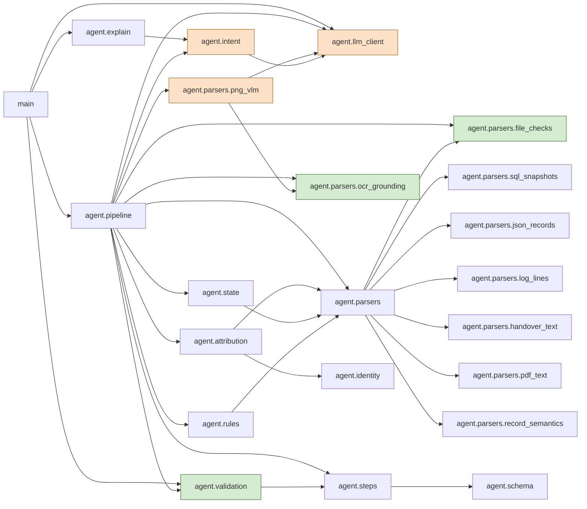

# Ghost Data Still Exists: deletion-audit agent

HackerRank Orchestrate, October 2026. For every request in `dataset/deletion_requests.csv`, the agent decides whether
deletion was requested, reconstructs the subject's current and historical identifiers, attributes records to the
subject, rebuilds each record's state at `audit_at` from the evidence, applies `dataset/deletion_rules.csv`, and writes
`COMPLETE`, `INCOMPLETE` or `NOT_APPLICABLE` with an ordered `steps_json` plan to `output.csv`.

**Architecture in one line.** The model reads request intent and the 11 screenshots; deterministic code makes every
decision that reaches the CSV. An investigator agent loop (experiment E2) was built and measured: on the 19
AMBIGUOUS timing-only sample pairs it made 126 proposals and its verifier accepted 0 (11 batches, 28 calls, 41,780
tokens; DESIGN.md D-E2 and rejection log). It was taken out of the decision path and archived.
- **E2 replay.** `python3 code/analysis/score_e2.py --from-cache` rebuilds `code/evaluation/e2_results.json`
  byte-identically, without keys, at the experiment's commit `63c7ecb`.
- **Why not on the current code.** A1 later changed which pairs are ambiguous, so the investigator prompts differ,
  and the replay stops on a cache miss (exit 1) instead of calling a model. That it can never resolve a pair is an
argument, not a measurement: its verifier accepts only identity-link support, and attribution already confirms every
such link.

**Reproduce (no API keys, no network, no Tesseract):**

```bash
python3 -m pip install -r requirements.txt
python3 code/main.py --from-cache                           # rebuilds output.csv from the committed cache; exit 0
python3 code/evaluation/main.py --from-cache --determinism  # sample metrics, custom cases, 3-seed determinism
```

Every cached model reply records the prompt that produced it, and every one of those prompts ships in `code/prompts/`
(`intent.md`; `image_extraction.md` is the current vision prompt, `image_extraction_v1.md` the legacy one behind 10 of
the 11 screenshot replies). `code/tests/test_prompt_provenance.py` enforces this. A live re-extraction is **not**
guaranteed to reproduce the cache. Re-reading the 10 legacy screenshots with the current prompt changed 2 eval rows
(case_61 lost object_19 and became INCOMPLETE [], case_34 gained an unverifiable finding), so it was rejected (DESIGN.md
rejection log, G6).

**What to read first**

| Path | What it is |
|---|---|
| `code/main.py` | Entry point (run, `--from-cache`, `--explain`, exit codes) |
| `code/agent/` | The pipeline: `pipeline.py` (orchestration), `attribution.py`, `state.py`, `rules.py`, `steps.py`, `validation.py`, evidence parsers under `parsers/` |
| `code/evaluation/` | Evaluation: `main.py` writes `evaluation_report.md` and `usage_report.md`; `spec_audit.py` (literal spec audit with a negative control), `coupling_probes.py`, `security_audit.py`, `cache_audit.py`, custom cases X1–X19 |
| `code/analysis/` | Offline analysis and archived experiments: Phase 0 profiling; the rejected E1 ordering, E2 investigator and rc8 capacity probe. `score_e1.py` and `score_e2.py` produce `e1_results.json` and `e2_results.json`; both replay byte-identically at `63c7ecb`. Re-run on the current code (rc9), E1 still makes one wrong owner per strategy: A 2 correct / 1 incorrect, B 1 / 1 of the 19 pairs. `code/agent/` and `code/main.py` import nothing from it; `code/evaluation/main.py` imports one table builder from it (`category_coverage.py`) |
| `code/evaluation/evaluation_report.md` §7 | Known limitations and judgement calls (ambiguous accounts, case_63, F1, D-SCOPE) |
| `code/evaluation/experiment_ledger.md` | The latest round's experiments, kept and rejected, with evidence and measured effect (earlier rounds: DESIGN.md) |

**Execution path.** `main.py` calls `agent.pipeline.run`, which does the following:
1. Loads and validates the CSVs.
2. Builds one evidence index (`parsers.build_evidence_index`). Each file passes `file_checks` before parsing, and
   screenshots go through the cached vision extraction plus OCR grounding.
3. Resolves identities (`identity.IdentityUniverse.resolve`).
4. Labels intent once per distinct request text (`intent.IntentClassifier.classify`, then `intent.decide`).
5. Attributes records to cases across all cases at once (`attribution.attribute`).

Then `pipeline.audit_case` runs once per case: `state.reconstruct` at audit_at, then `rules.Policy.category` and
`Policy.verdict`, then `steps.build_steps`, then `validation.validate_row`. `main.py` writes the rows to a temporary
file and replaces `output.csv` only if `validation.validate_output_file` passes (exit codes below).

**Cached model replies.**
- **Where they live.**
  - `code/cache/intent/` (request-intent replies);
  - `code/cache/vision/` (screenshot extractions);
  - `code/cache/ocr/` (Tesseract text, keyed by image and engine);
  - `code/cache/investigator/` (the archived E2 run);
  - `code/cache/compare_*` (the intent-model comparison).
- **Key.** A model reply is keyed by sha256(task + prompt version + input). The prompt version is a hash of the
  rendered prompt, so a reply from another prompt never passes as the current prompt's reply.
- **The one deliberate exception.** A screenshot with no reply under the current prompt reuses a reply for the same
  image bytes only if that reply's prompt also ships (`image_extraction_v1.md`). Its legacy null field is upgraded
  to UNKNOWN, and every reuse is listed in `code/traces/_run_summary.json` (`image_legacy_replies_upgraded`). In
  the submitted run, 10 of the 11 screenshots are read this way (`test_legacy_reuse_needs_a_shipped_prompt_and_the_same_image`).
- **Determinism.** Everything after the replies is deterministic code. `--from-cache` rebuilds `output.csv`
  byte-identically: the same sha256 across 3 seeds, and again from `code.zip` in an empty folder (`clean_room.py`;
  hashes in DESIGN.md §14).
- **Live runs.** The model replies themselves are external and not guaranteed to repeat. A live re-extraction under
  the current vision prompt changed 2 eval rows, as described above.

Design, decisions and rejected alternatives: [`DESIGN.md`](DESIGN.md). Measured results:
[`code/evaluation/evaluation_report.md`](code/evaluation/evaluation_report.md) and
[`code/evaluation/usage_report.md`](code/evaluation/usage_report.md).

## How it works

### Architecture

A **deterministic decision core** with **Gemini perception behind a typed seam**. The model does two jobs only:
it labels request intent (`agent.intent`) and reads the 11 screenshots into enum-validated observations
(`agent.parsers.png_vlm`). Everything that reaches the CSV (status, every step, every id, every citation) is
computed by code from typed records (Observation, Identifier, ActivityClaim, Attribution, ResourceState, Verdict).
Code verifiers sit on both sides of the seam: evidence admission checks before parsing (`file_checks`), multi-pass
OCR grounding after extraction (an id is accepted only if it is visibly on the screen, `ocr_grounding`), schema and
id validation of every model reply, and row/file validators before output.csv is replaced (`validation`).

**Why there is no free-form agent loop in the decision path.** One was built and measured: experiment E2, a
tool-calling investigator with five read-only tools and a deterministic verifier
([`code/analysis/e2_investigator.py`](code/analysis/e2_investigator.py),
[`e2_investigator_tools.py`](code/analysis/e2_investigator_tools.py),
[`e2_investigator_verifier.py`](code/analysis/e2_investigator_verifier.py)). On the samples it made 126 proposals,
all AMBIGUOUS; 0 were accepted. The ceiling is structural: the verifier may accept only identity-link support, and
any identity link the tools can reach is already a hard link that attribution marks CONFIRMED, so the loop can add
cost and risk but no correct decisions. It was removed from the pipeline and archived under `code/analysis/`.

Import graph of the shipped code (every arrow is an import, importer → imported; `agent.schema`, `agent.loaders` and
`agent.identity` are shared utilities and only their non-trivial edges are drawn; checked against the AST imports by
`code/tests/test_architecture_diagram.py`):



Orange: the only components that call a model (perception). Green: code verifiers. Everything else is the
deterministic core.

The model does exactly two jobs; code decides everything that reaches the CSV.

| Stage | Module | Model? |
|---|---|---|
| Load and validate CSVs | `code/agent/loaders.py` | no |
| Parse evidence into typed observations: SQL in in-memory SQLite, JSON, six log syntaxes with trace joins, the handover text, PDF text layers (stdlib decoder) | `code/agent/parsers/` | no |
| Read the 11 PNG screenshots into the same observation schema; output validated against known systems/prefixes | `code/agent/parsers/png_vlm.py` | **yes** (vision) |
| Ground every screenshot resource id in local OCR text of the same image (an id not visible is dropped) | `code/agent/parsers/ocr_grounding.py` | no (Tesseract, local) |
| Request intent: `DELETION` / `NON_DELETION` / `UNCLEAR` | `code/agent/intent.py`, prompt `code/prompts/intent.md` | **yes** (text) |
| Identity: request email → user_id → identifier set with provenance | `code/agent/identity.py` | no |
| Attribution: global constrained assignment; labels CONFIRMED / INFERRED / AMBIGUOUS / CONFLICT | `code/agent/attribution.py` | no |
| State at `audit_at` and citation rule C | `code/agent/state.py` | no |
| Category → treatment from `deletion_rules.csv` | `code/agent/rules.py` | no |
| Step generation, ordering, serialization | `code/agent/steps.py` | no |
| Row and file validation | `code/agent/validation.py` | no |

Safety properties enforced in code:
- The model never writes `deletion_status`, `operation`, `state`, `system_id`, `resource_id` or `evidence_id`.
- `UNCLEAR` or a model failure becomes `NOT_APPLICABLE`; an empty request text is `NOT_APPLICABLE` without a call, and texts are capped at 5,000 characters for classification.
- A screenshot id the model reports is kept only if the exact token is in the image's OCR text.
- AMBIGUOUS or CONFLICT attributions produce no steps, so no remediation is ever planned against data that may belong to someone else.
- Evidence captured after `audit_at` is never used for state or citation.

## Setup

```bash
python3 -m pip install -r requirements.txt
```

Python 3.10 or newer is required. HTTP calls use the standard library.

### OCR engine (screenshot id grounding)

`pytesseract` (pinned in `requirements.txt`) needs the Tesseract binary; the committed results were produced with
Tesseract 5.5.3. Install it from your package manager (`apt install tesseract-ocr`, `brew install tesseract`, or the
UB Mannheim installer on Windows). The binary is found through `TESSERACT_CMD`, then `PATH`, then
`C:/Program Files/Tesseract-OCR/tesseract.exe`. OCR text is cached in `code/cache/ocr/` by sha256(image + engine
version), so `--from-cache` runs need no Tesseract at all; a live run without the cache and without Tesseract stops
with exit 3 instead of accepting ungrounded ids.

### API keys (only needed for live runs)

Keys are read only from environment variables, or from an uncommitted `.env` file at the repository root (it is gitignored):

```text
GEMINI_API_KEY=...              # primary key
GEMINI_API_KEY_FALLBACK_1=...   # used when the primary is exhausted or failing
GEMINI_API_KEY_FALLBACK_2=...   # used when fallback 1 is exhausted or failing
GEMINI_API_KEY_FALLBACK_3=...   # ... and so on, in order
GEMINI_API_KEY_FALLBACK_4=...
GEMINI_API_KEY_FALLBACK_5=...
GEMINI_API_KEY_FALLBACK_6=...
GROQ_API_KEY=...                # optional; not used by the committed run
TESSERACT_CMD=...               # optional path to the tesseract binary
```

Any subset works: a missing or empty key slot is skipped and logged. Probe results per key alias (never the values)
are in `code/evaluation/models_verified.json`; quota pools are UNKNOWN because keys of one project share a quota.

The model ids, rate limits and fallback order live in `code/config/models.yaml`. Retries and caps: `MAX_SCHEMA_RETRIES` (a reply that fails schema validation is retried on the same model with the validator's error), `MAX_HTTP_RETRIES` and `MAX_BACKOFF_SECONDS` (429/5xx/timeout, exponential backoff) in `code/agent/llm_client.py`, mirrored by `limits` in models.yaml; after them the next (model, key) in the task's `attempts` list is tried, a 404 or a daily-quota 429 retires that (model, key) for the run, and all failures exit 4. Check them against the provider's
current model list with:

```bash
python3 code/main.py --check-models
```

## Run

Live (model calls only for items not already cached in `code/cache/`):

```bash
python3 code/main.py
```

Reproduce from the committed cache (zero network calls, no keys needed; fails loudly if a cache entry is missing):

```bash
python3 code/main.py --from-cache
```

Outputs:
- `output.csv`: 518 rows sorted by case_id, header `case_id,deletion_status,steps_json`. It is written to a temporary file and only replaces `output.csv` after the whole file validates.
- `code/evaluation/sample_predictions.csv`: predictions for the 32 public sample cases.
- `code/traces/<case_id>.json`: identifiers with provenance, candidate edges, attribution labels with rationale, state per resource with cited evidence, the rule that fired, the intent path and provider. `code/traces/_run_summary.json` holds the counts.
- `code/evaluation/usage_ledger.json`: live calls, the cache entries read, and fallback events for the run. Every cache entry carries the provider's usage metadata, so `usage_report.md` is rebuilt from the entries the run read.

Exit codes (also in `python3 code/main.py --help`):

| Code | Meaning | output.csv |
|---|---|---|
| 0 | ok | replaced with the new rows |
| 2 | output validation failed | untouched |
| 3 | cache miss under `--from-cache` (or no OCR cache and no Tesseract) | untouched |
| 4 | model failure (an intent call or a screenshot extraction failed) | untouched; `--allow-degraded` writes the diagnostic rows to `output.degraded.csv` |

Explain one case stage by stage (read-only; never writes output.csv). It prints identity resolution with provenance,
attribution labels and edges, observations per resource (with OCR grounding), the rules fired, the intent path and the
final steps:

```bash
python3 code/main.py --case case_25 --explain --from-cache
```

Trace a new request live (the text is data for the intent classifier only; at most 5,000 characters; timestamps are
ISO-8601 with a zone; malformed input exits 2; with `--from-cache` an unseen text exits 3):

```bash
python3 code/main.py --explain --from-cache --email s.yoon04@gmail.com --audit-at 2026-09-15T12:00:00Z --request-text "Please permanently delete my account and the personal data linked to it."
```

Evaluate (sample metrics, attribution metrics, root causes, category coverage, custom cases X1–X19 including the
adversarial X14–X19, determinism over three processes, usage report):

```bash
python3 code/evaluation/main.py --from-cache --determinism
```

Unit tests (pure code: no model calls, keys removed by a fixture):

```bash
python3 -m pytest code/tests -q
```

## Privacy note

Free-tier Gemini usage may allow the provider to use prompts to improve its products. The dataset is synthetic (an
imaginary company, fictional people), so no real personal data is sent. Only request texts and the 11 screenshots
go to the provider; logs, JSON, SQL and PDFs are parsed locally, and OCR runs locally. Keys are never logged, cached or
committed; reports name key aliases only.

## Packaging

`code.zip` holds README.md, requirements.txt, `code/` (including `code/DESIGN.md`, `code/CONSTANTS.md`, the committed cache and the
evaluation scripts) and `evaluation/` (the two reports at the path the problem statement names). With `zip`:

```bash
zip -r code.zip README.md requirements.txt code evaluation -x "*/__pycache__/*" "*/.venv/*" "*/venv/*" "*/node_modules/*" "*/.git/*" "*/.DS_Store"
```

Without `zip` (stdlib, same inputs and exclusions, byte-identical for identical inputs, prints the sha256):

```bash
python3 code/package.py
```

`DESIGN.md` and `CONSTANTS.md` are edited at the repository root; `python3 code/sync_docs.py` writes the shipped copies
in `code/` (it refuses to overwrite a copy edited directly), and `code/package.py` refuses to build while they differ.

Challenge and submission page: https://wwww.hackerrank.com/contests/hackerrank-orchestrate-october26/challenges/ghost-data-still-exists
